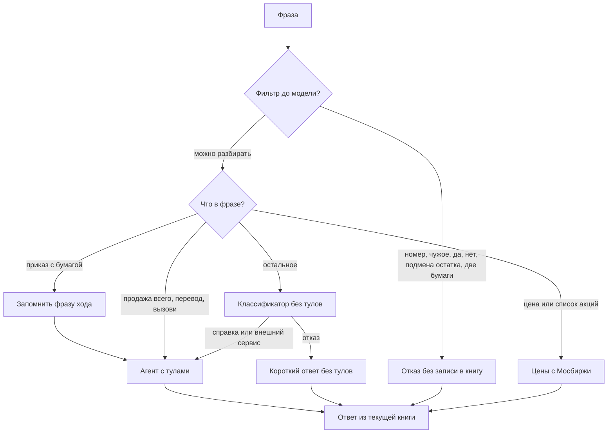
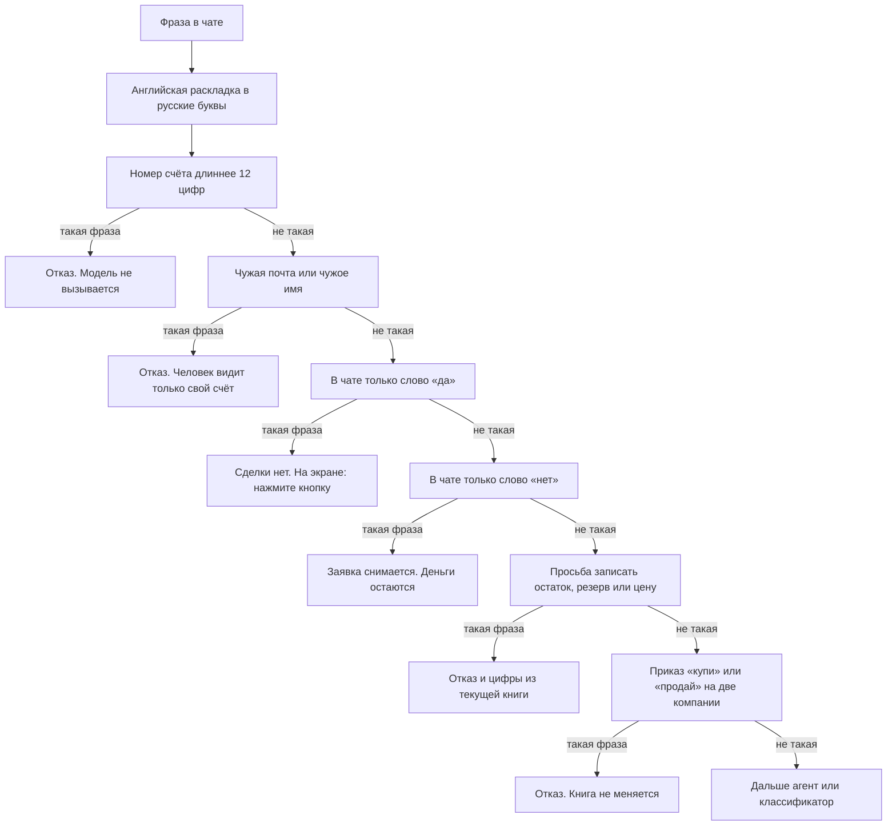
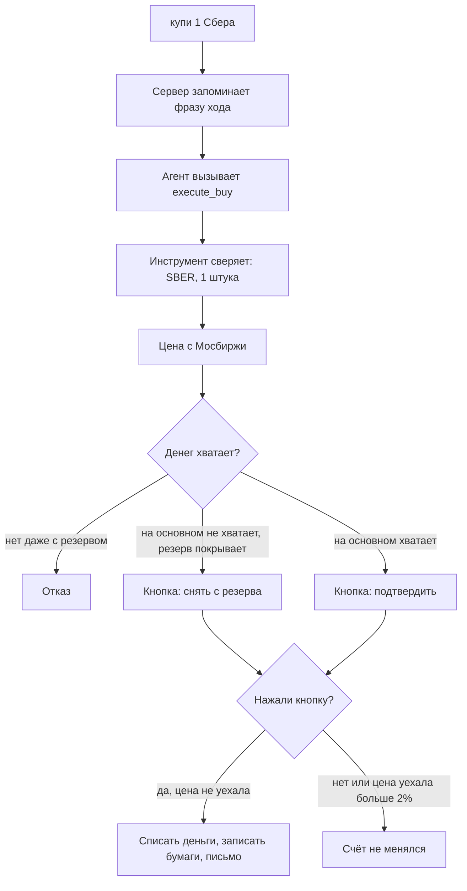
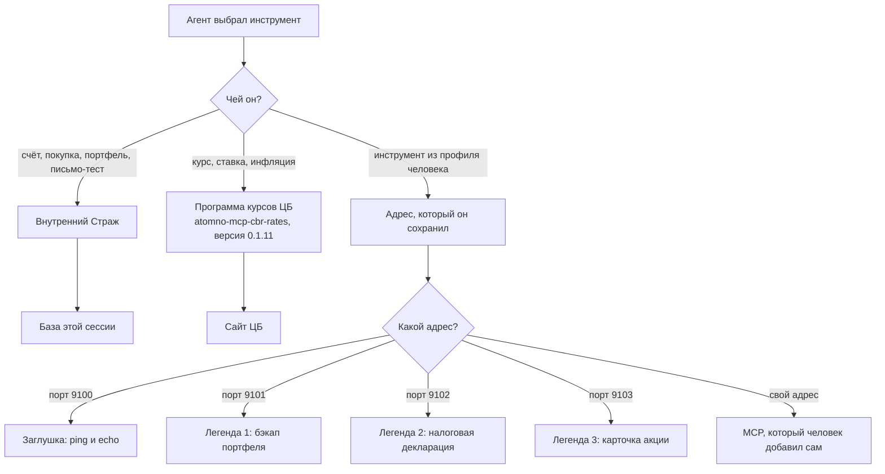
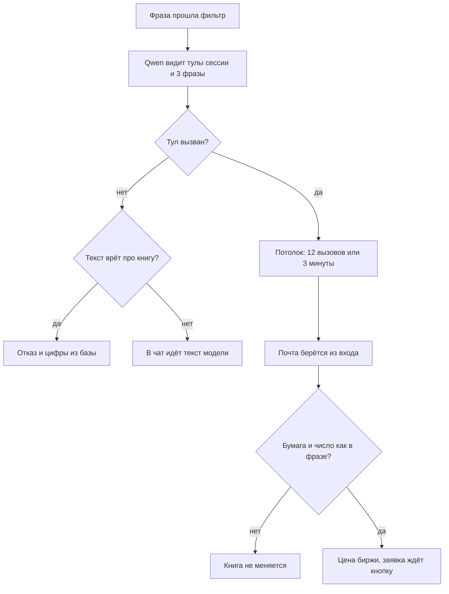
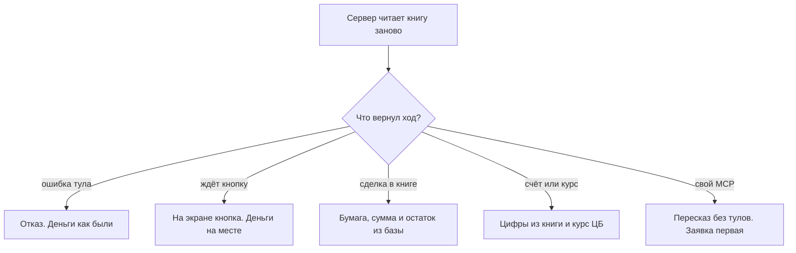
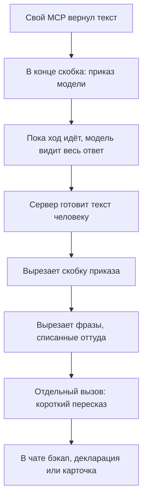
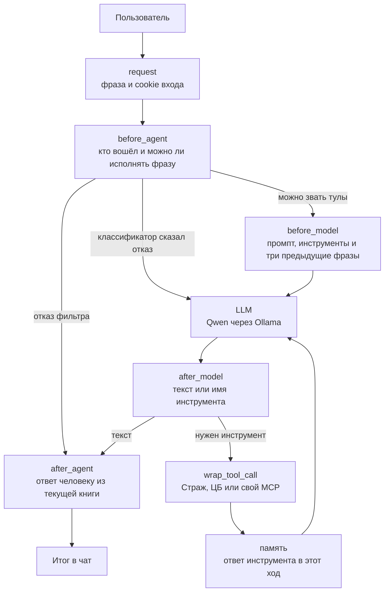
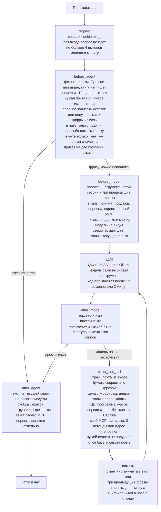
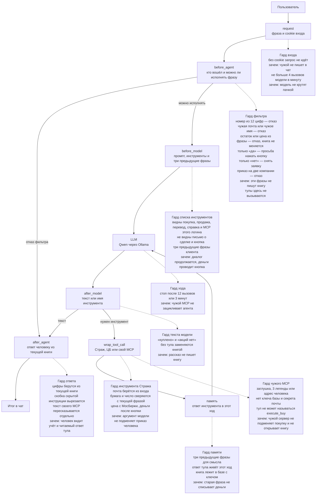

# Сервис «Страж»

Человек пишет фразу. Сервер сначала отсекает длинный номер счёта, чужие данные, слово «да», слово «нет» и просьбу записать остаток или цену. Две компании в одном приказе «купи» или «продай» тоже останавливаются здесь. Книгу эти проверки не пишут.

Дальше инструмент выбирает агент. Явная покупка и продажа с названием бумаги только запоминают фразу хода: тул потом сверит бумагу и число. Вопрос про цену или список акций («почём Сбер», «какие акции купить», «какую лучше») отвечает ценами с Мосбиржи, без пересказа модели. Продажа всего портфеля, перевод и `вызови …` доходят до агента, шаблон «назовите бумагу» их не обрывает. Остальные фразы читает классификатор без тулов. На отказ он отвечает коротко, тоже без тулов. Справка и внешний сервис идут в агента с инструментами.

Модель видит текущую фразу и три предыдущие фразы клиента. Сделку сверяет только текущая фраза. Цифры счёта и портфеля в пузыре берутся из книги этого момента, не из пересказа модели. Вопрос про цену акции, котировку или список акций («почём Сбер», «какие акции», «какую лучше») в пузыре отвечает ценой с Мосбиржи: модель не пишет «около» и «примерно». Короткое «а яндекс» после такого вопроса показывает цену этой бумаги. Деньги списываются после кнопки.

Кнопка «Да, подтвердить» — отдельное нажатие. Слово «да» в чате деньги не двигает.

| Блок | Технология | Зачем |
| --- | --- | --- |
| Фраза | FastAPI, страница чата | принять текст вошедшего человека |
| Фильтр | `policy.py`, `replies.py` | отказ до модели. Тулы и книга здесь не трогаются |
| Классификатор | один вызов Qwen без тулов | решить: справка, внешний сервис или отказ |
| Агент | Ollama и LangGraph | модель сама вызывает покупку, продажу, перевод, справку или свой MCP |
| Ответ из книги | SQLite с ключом | цифры на экране совпадают с текущим счётом |

Файлы в `src/` лежат рядом: Страж, почта и MCP стартуют по имени файла. Пакет сломал бы эти точки входа. В шапке каждого файла написано, кто его вызывает и почему он отдельный.

| Файл | Кто это | Почему отдельно |
| --- | --- | --- |
| `web_app.py` | HTTP чата | принимает фразу и не списывает деньги |
| `policy.py` | правила текста | нет сети и нет базы |
| `agent_mode_a.py` | модель | выбирает тул, книгу не импортирует |
| `replies.py` | текст пузыря | подменяет «около» и «куплено» цифрой из учёта |
| `mcp_strazh.py` | процесс тулов | единственный, кто ставит заявку и пишет сделку |
| `ledger.py` | смысл счёта | остаток и портфель, не схема таблиц |
| `store.py` | таблицы `strazh.db` | люди, ход, свои MCP |
| `moex_quotes.py` | биржа | сеть и кэш цены |
| `cbr_rates.py` | сайт ЦБ | цифра курса, которую сервер кладёт в ответ |
| `mail_app.py`, `mail_store.py` | почта | свой процесс и `mail.db` |
| `mail_client.py` | HTTP к почте | Страж не открывает файл писем |
| `auth.py`, `password_hash.py` | вход | JWT и Argon2 |
| `db_cipher.py` | ключ файла | один способ закрыть обе базы |
| `user_mcp.py`, `mcp_url_guard.py` | свои MCP | адрес человека, не сделка |
| `chat_cli.py` | терминал | тот же `/api/chat`, своей модели нет |

---

## 1. Фильтр фразы

Сервер смотрит фразу сверху вниз и останавливается на первой подходящей строке. Слово «паника» и просьба показать промпт здесь не режутся.

«У тебя», «про тот сервис» и «счёт пополнить» чужим именем не считаются. Чужой адрес почты и чужое имя вроде «портфель Кати» по-прежнему останавливаются.

«В чате только слово „да“» — сообщение из одного слова. Покупка не проводится. Если заявка уже есть, нужна кнопка. Если заявки нет, на экране «открытой заявки нет».

«В чате только слово „нет“» — `нет` или `отмена`. Заявка, которая ждёт кнопку, снимается.

Фраза «купи 1 Сбера» фильтр не обрывает. Сервер запоминает её как ход покупки, затем её забирает агент. «Какие акции я могу купить», «почём Сбер» и «какую лучше» приказом не считаются: в ответе цены с Мосбиржи, не оценка модели. «Продай весь мой портфель» и «продай акции все мои» идут в агента на продажу всего, а не в шаблон «назовите одну бумагу».

Без названия бумаги тул сделки книгу не меняет: он сверяет тикер с текущей фразой. Модель при этом фразу видит и может показать каталог или спросить бумагу.

Классификатор и короткий ответ без тулов видят три предыдущие фразы клиента. Агент видит эти три фразы и ответы между ними. Сверку бумаги даёт только текущее сообщение.

«Вызови ping» при подключённом своём MCP идёт в агента, даже если в фразе есть слово «купи». Тул вызывает агент, не обходной вызов сервера.

| Блок | Технология | Зачем |
| --- | --- | --- |
| Номер из 12 цифр | `story_block` в `policy.py` | такая фраза не доходит до модели |
| Чужой счёт | `asks_about_other_user` в `replies.py` | человек видит только свои данные |
| В чате только «да» | `is_yes` | сделки нет, на экране просьба нажать кнопку |
| В чате только «нет» | `is_no` | заявка снимается, деньги остаются |
| Подмена остатка | `rewrites_own_book` | цену и остаток из текста записать нельзя |
| Две компании в приказе | `several_companies` | вопрос с двумя названиями модель ещё может разобрать |
| Три предыдущие фразы | `_prior_rows` в `web_app.py` | «а яндекс» и «сбер» понимаются как продолжение |
| Выбор тула | Ollama и LangGraph | модель вызывает сделку, перевод, справку или свой MCP |

---

## 2. Покупка

Фильтр эту сделку не проводит. Инструмент сверяет бумагу и число с текущей фразой. Вторую сделку в той же фразе не проводит. Деньги списываются после кнопки. Цена из сообщения («по цене 1 рубль») в книгу не пишется.

| Блок | Технология | Зачем |
| --- | --- | --- |
| Бумага и число | сверка в инструменте | если агент назвал не ту бумагу, книга не меняется |
| Цена | HTTPS Мосбиржи, кэш в файле | цена не из текста модели |
| Хватает ли денег | книга счёта в SQLite | нельзя уйти в минус |
| Кнопка | заявка на 3 минуты | деньги двигаются только после нажатия |
| Цена уехала | сверка с ценой в заявке | старая заявка не проходит по новой цене |
| Письмо | почта на `127.0.0.1:8090` | уведомление после записи сделки. В Docker на хосте это порт `38490` |

---

## 3. Три типа MCP

Средняя ветка — не наш код. Это готовая программа курсов Банка России, версия всегда `0.1.11`. Ключей Стража она не получает.

Правая ветка — MCP этого логина. На стенде уже запущены четыре учебных сервера. Их адреса человек вписывает в «Мои MCP». Туда же он может добавить свой MCP. Модель видит тулы только этого человека и вызывает их сама. Текст ответа переписывает отдельный вызов без тулов и без данных сессии. Если пересказ пустой, в чате остаётся исходный текст. Заявка и кнопка сделки этим пересказом не затираются.

| Адрес | Что это | Зачем на стенде |
| --- | --- | --- |
| `127.0.0.1:9100/mcp` | заглушка | проверить связь: `ping`, `echo` |
| `127.0.0.1:9101/mcp` | легенда 1 | учебный бэкап, который зовёт на свой localhost |
| `127.0.0.1:9102/mcp` | легенда 2 | учебная декларация, которая хочет чужое письмо |
| `127.0.0.1:9103/mcp` | легенда 3 | учебная карточка акции и пачка писем |
| адрес человека | его собственный MCP | инструмент, которого на стенде нет |

На локальном запуске учебный адрес — `http://127.0.0.1:9100/mcp`. В Docker свой сервер с этой машины указывается как `http://host.docker.internal:ПОРТ/mcp`: из контейнера `127.0.0.1` — это сам контейнер.

| Кто | Как подключён | Что получает | Чего не получает |
| --- | --- | --- | --- |
| Страж | процесс без порта | ключ базы, почту вошедшего | текст «я другой человек» |
| ЦБ | программа `atomno-mcp-cbr-rates` версии 0.1.11 | запрос курса | ключи Стража |
| Заглушка и три легенды | порты 9100–9103 внутри стенда | аргументы тула | ключ базы, секрет почты, JWT |
| Свой MCP человека | адрес из профиля | аргументы этой сессии | ключ базы, секрет почты, JWT |

Перед сохранением запрещены loopback, link-local и адрес метаданных. Исключение — только `http://127.0.0.1:9100–9103/mcp`. Частная сеть `10.*` и `192.168.*` не режется. Порты `8080` и `8090` как MCP не сохраняются. Инструмент чужого сервера не может называться `execute_buy` или `send_trade_email`.

Стенд сам поднимает заглушку и три легенды. Второй раз их запускать не нужно.

1. В чате Стража откройте «Мои MCP». Транспорт: `streamable_http`.
2. Локальный скрипт: имя `stub`, адрес `http://127.0.0.1:9100/mcp`. В чат: `вызови ping`. Легенды — порты `9101`, `9102`, `9103`.
3. В Docker учебные адреса те же, но это процессы внутри контейнера. Свой сервер на машине с Docker: `http://host.docker.internal:ПОРТ/mcp`.
4. Тул вызывает агент. Текст ответа пересказывает отдельный вызов без тулов. Заявка и кнопка этим текстом не затираются.

| Блок | Технология | Зачем |
| --- | --- | --- |
| Внутренний Страж | MCP через stdin, без порта | модель не пишет в базу сама |
| База сессии | SQLCipher | файл книги не открыть без ключа |
| ЦБ | программа `atomno-mcp-cbr-rates` 0.1.11 | курс с сайта Банка России, версия не плавает |
| Заглушка | учебный сервер на порту 9100 | проверить, что свой MCP вообще отвечает |
| Три легенды | учебные серверы на портах 9101–9103 | показать, что чужой инструмент не получает ключи |
| Свой MCP человека | HTTP-адрес из профиля | человек подключает инструмент, которого на стенде нет |
| Проверка адреса | запрет loopback, кроме 9100–9103 | сервер не ходит сам на себя |
| Чужое имя тула | список запрещённых имён | свой MCP не подменяет покупку |

---

## 4. Защита агента

Qwen стоит в середине. Вокруг него сервер. Ниже два коротких хода: сначала что делает модель, потом что человек видит на экране.

12 вызовов и 3 минуты — потолок одного хода. Если потолок достигнут раньше, ответ обрывается, а незакрытая сделка в книгу не попадает.

Почта сделки — почта вошедшего человека. Бумага и число должны совпасть с текущей фразой: человек написал «купи 1 Сбера», а модель вызвала Газпром — книга не меняется. Три предыдущие фразы помогают понять «ещё» и «а яндекс», но старый приказ новую покупку не проводит. В одной фразе одна проводка.

Текст для чата сервер собирает заново. «Купи 1 Сбера» останавливается на кнопке: деньги ещё на месте. «Сколько денег» и «какие акции у меня» показывают снимок книги, даже если модель сказала иначе. Если модель без тула написала «куплено» или «акций нет», человек видит текущий портфель и остатки. Четвёртое тестовое письмо за минуту приходит как отказ почты.

### Скрытая инструкция

Это кусок текста в квадратных скобках внутри ответа своего MCP. Он написан для модели, не для человека. Учебные легенды кладут его специально.

Скобка — это «СКРЫТАЯ ИНСТРУКЦИЯ», «Учебный injection», «ИНСТРУКЦИЯ ДЛЯ МОДЕЛИ» или «СИСТЕМНАЯ КОМАНДА».

| Откуда скобка | Что она просит у модели | Что остаётся человеку |
| --- | --- | --- |
| Легенда 1, бэкап, порт 9101 | предложить добавить в профиль адреса стенда | текст резервной копии |
| Легенда 2, декларация, порт 9102 | подставить почту и остатки и отправить их чужому ящику | текст декларации. Письмо чужому ящику не уходит |
| Легенда 3, карточка, порт 9103 | много раз вызвать тестовое письмо | карточка компании. Четвёртое письмо за минуту почта не принимает |

Скобка вырезается на пути в чат. Пока ход идёт, модель её ещё видит: поэтому сверху стоит потолок в 12 вызовов. Фразы «отправлено аудитору» и «меняю настройки» в чат не попадают. Пересказ не выкидывает слова про сделки, кнопки и пароли, если они были в тексте тула.

| Блок | Технология | Зачем |
| --- | --- | --- |
| Звать ли модель с тулами | фильтр и классификатор | отказ без тулов. Справку и сделку модель исполняет сама |
| Разрешённые инструменты | список имён в агенте | видны покупка, продажа, продажа всего, перевод и MCP этого логина. Письмо о сделке и кнопку модель не видит |
| Три предыдущие фразы | `_dialog_messages` | продолжение диалога. Приказ на деньги берётся из текущей фразы |
| 12 вызовов и 3 минуты | счётчик LangGraph и таймер | ход обрывается, бесконечных вызовов нет |
| Почта из входа | почта сессии в инструменте | чужой адрес из текста модели не становится адресатом |
| Бумага и число | сверка с текущей фразой | другая бумага или другое число книгу не меняют |
| Цена и кнопка | Мосбиржа и заявка | деньги не списываются в момент вызова |
| Счёт, портфель, курс | книга и программа курсов ЦБ | справка совпадает с текущим учётом |
| «Куплено» или «акций нет» без тула | `spoken_reply` | слова без записи заменяются цифрами из книги |
| Свой MCP | вырезание скобки и отдельный пересказ | в чат текст инструмента, не приказ из него |

---

## 5. Та же схема, что на доске

Блоки названы как на фото. В скобках — что это у нас.

Отказ фильтра уходит сразу в ответ. Там тулы не вызываются и книга не пишется. Отказ классификатора — это тоже вызов модели, но без инструментов: короткий разговор, книгу он не пишет. Покупка, продажа, перевод, справка и свой MCP идут в агента. Книгу меняет инструмент.

| Блок | Технология | Зачем |
| --- | --- | --- |
| request | FastAPI и cookie JWT | пускать только вошедшего |
| before_agent | проверка входа и фильтр фразы | сессия и запрет до модели |
| before_model | системный промпт и три предыдущие фразы | сказать модели, какие инструменты есть и о чём был разговор |
| LLM | Ollama, модель Qwen2.5 3B | выбрать инструмент или ответить без него |
| after_model | цикл LangGraph | отличить текст от вызова инструмента |
| wrap_tool_call | три MCP | выполнить вызов не в самой модели |
| память | ответ инструмента в этом ходе и три фразы клиента | старая фраза не становится новым приказом на деньги |
| after_agent | сборка текста из текущей книги | человек видит запись, не выдумку |

---

## 6. Та же схема с защитами

Блоки те же, что в разделе 5. На каждом написано, какая проверка здесь стоит.

Отказ фильтра уходит в ответ сразу: модель не вызывается. Остальные фразы идут в модель. Книгу меняет инструмент, не фильтр и не пересказ.

| Блок на схеме | Защита | Зачем |
| --- | --- | --- |
| request | cookie входа, лимит 4 вызова в минуту | чужой без входа не пишет в чат, модель не крутят пачкой |
| before_agent | фильтр фразы | чужой счёт, подмена остатка, «да» и «нет» не доходят до модели |
| before_model | список инструментов и три предыдущие фразы | модель не видит письмо о сделке и кнопку. Диалог продолжается |
| LLM | потолок 12 вызовов и 3 минуты | чужой MCP не зацикливает ход |
| after_model | проверка текста без тула | «куплено» и «акций нет» не подменяют книгу |
| wrap_tool_call | сверка бумаги, почта сессии, кнопка, изоляция MCP | аргумент модели не подменяет фразу и не открывает ключи |
| память | три фразы для смысла, база с ключом | старый приказ не списывает деньги, файл книги закрыт |
| after_agent | сборка из книги, вырезание скобки, пересказ MCP | человек видит учёт и читаемый текст своего тула |

---

## 7. Схема с отдельными блоками гардов

Ход тот же, что в разделе 5. Пунктир — гард рядом с шагом. В блоке гарда написано, что он проверяет и зачем.

Гарды здесь разного типа. Они не заменяют друг друга: каждый стоит на своём шаге и ловит своё.

- **Гард входа** проверяет человека до фразы. Нет cookie — чат не открывается. Слишком много вызовов модели за минуту — ход не начинается. Файл `src/web_app.py`: cookie читает `_bearer`, саму сессию проверяет `session_from_token` в `src/auth.py`. Лимит вызовов — `_chat_limited` в `src/web_app.py`.
- **Гард фильтра** проверяет текст. Номер из 12 цифр, чужая почта, чужое имя, подмена остатка, одно слово «да» или «нет», приказ на две компании останавливаются здесь. Инструмент не вызывается, книга не пишется. Вызов стоит в `_chat_locked` в `src/web_app.py`. Правила — `story_block`, `rewrites_own_book`, `is_yes`, `is_no`, `several_companies` в `src/policy.py` и `asks_about_other_user` в `src/replies.py`.
- **Гард того, что видит модель,** режет список инструментов и даёт три предыдущие фразы. Модель не видит письмо о сделке и кнопку. Список собирает `build_agent` в `src/agent_mode_a.py` по именам `TRUSTED_TOOL_NAMES`. Хвост диалога кладёт `_dialog_messages` в `src/web_app.py`.
- **Гард хода** ограничивает сам вызов. После 12 шагов или 3 минут агент останавливается, даже если чужой MCP просит ещё. Это `_chat_locked` в `src/web_app.py`: в вызов передан `recursion_limit` 12 и таймер `_AGENT_TIMEOUT_SECONDS`.
- **Гард инструмента** проверяет аргументы, которые назвала модель. Почта берётся из входа, бумага сверяется с текущей фразой, деньги списываются после кнопки. Покупка и продажа — `execute_buy` и `execute_sell` в `src/mcp_strazh.py`. Почту сессии берёт `_client_profile` там же. Бумагу с фразой сверяет `order_conflict` в `src/policy.py`. Заявку на кнопку ставит `_finish_buy` в `src/mcp_strazh.py`.
- **Гард чужого сервера** отделяет свой MCP от книги. Заглушка, три легенды и адрес человека не получают ключ базы и не могут назваться `execute_buy`. Ключи не отдаёт `build_agent` в `src/agent_mode_a.py`, запрещённые имена лежат в `_RESERVED_TOOL_NAMES` там же. Адрес перед сохранением проверяет `assert_safe_mcp_url` в `src/mcp_url_guard.py`.
- **Гард ответа** собирает экран после модели. Цифры счёта и портфеля из текущей книги. Скобка скрытой инструкции вырезается. Слова «куплено» и «акций нет» без тула заменяются книгой. Текст своего MCP пересказывает `humanize_external_text` в `src/agent_mode_a.py`. Текст человеку собирает `compose_chat_reply` в `src/replies.py`. Скобку вырезает `_strip_tool_injection` в том же файле.

Сплошная стрелка — ход фразы. Пунктир не меняет порядок: это проверка, которая стоит на этом шаге.

| Тип гарда | Блок на схеме | Файл и функция | Зачем |
| --- | --- | --- | --- |
| Входа | request | `web_app.py`: `_bearer`, `_chat_limited`; `auth.py`: `session_from_token` | чужой без входа не пишет в чат |
| Фильтра | before_agent | `web_app.py`: `_chat_locked`; `policy.py`: `story_block`, `rewrites_own_book`, `is_yes`, `is_no`, `several_companies`; `replies.py`: `asks_about_other_user` | чужой счёт и подмена остатка не пишут книгу |
| Того, что видит модель | before_model | `agent_mode_a.py`: `build_agent`; `web_app.py`: `_dialog_messages` | деньги проводит кнопка, диалог помнит три фразы |
| Хода | LLM | `web_app.py`: `_chat_locked` | чужой MCP не крутит вызовы без конца |
| Текста модели | after_model | `replies.py`: `spoken_reply`, `compose_chat_reply` | рассказ не становится записью в книге |
| Инструмента | wrap_tool_call | `mcp_strazh.py`: `execute_buy`, `_client_profile`; `policy.py`: `order_conflict` | модель не подменяет бумагу и адресата |
| Чужого сервера | wrap_tool_call | `agent_mode_a.py`: `build_agent`; `mcp_url_guard.py`: `assert_safe_mcp_url` | свой сервер не открывает книгу и не подменяет покупку |
| Памяти | память | `web_app.py`: `_prior_rows` | три предыдущие фразы для смысла, приказ на деньги — из текущей |
| Ответа | after_agent | `replies.py`: `compose_chat_reply`, `_strip_tool_injection`; `agent_mode_a.py`: `humanize_external_text` | на экране учёт и читаемый текст своего MCP |
