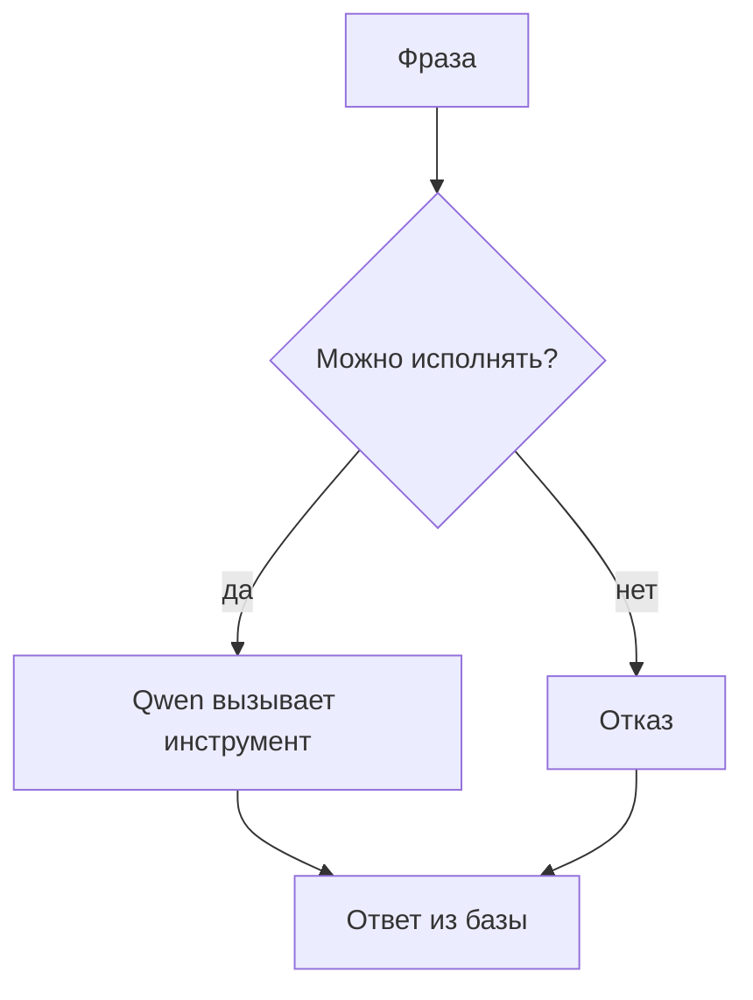
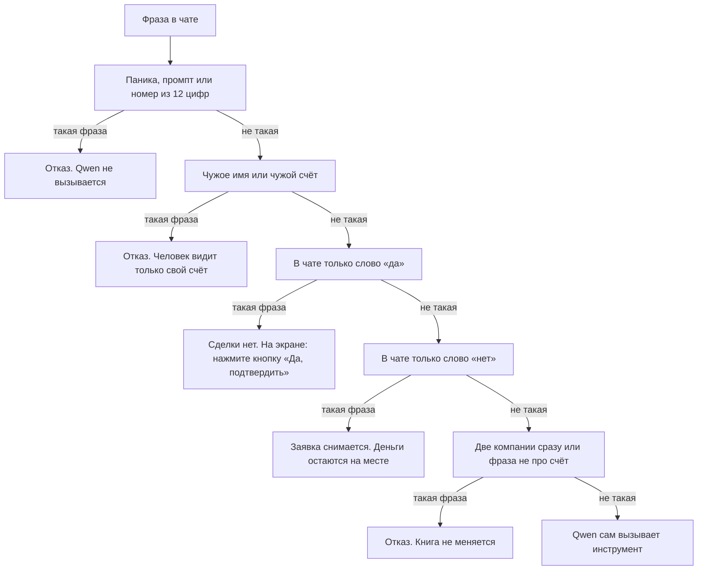
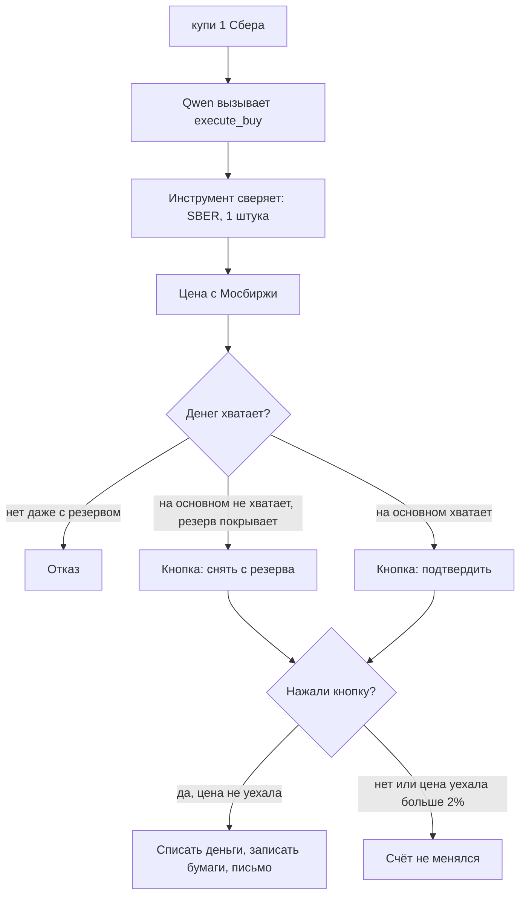
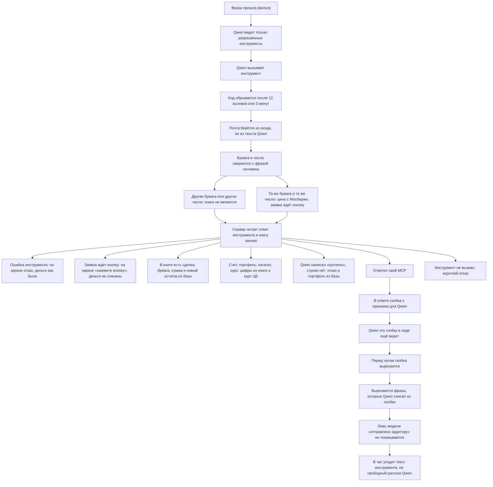
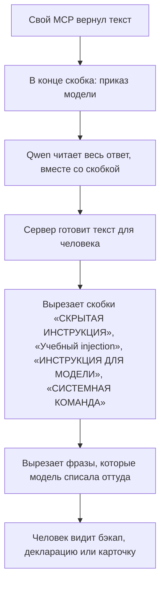
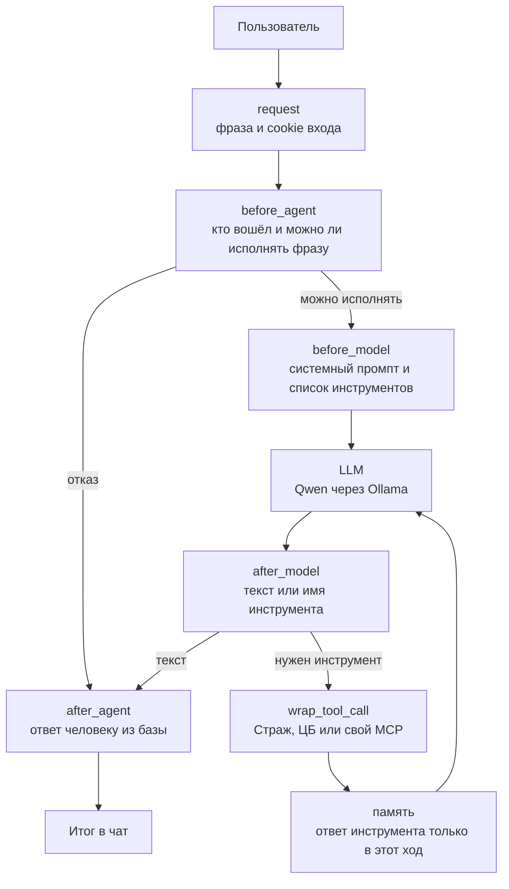
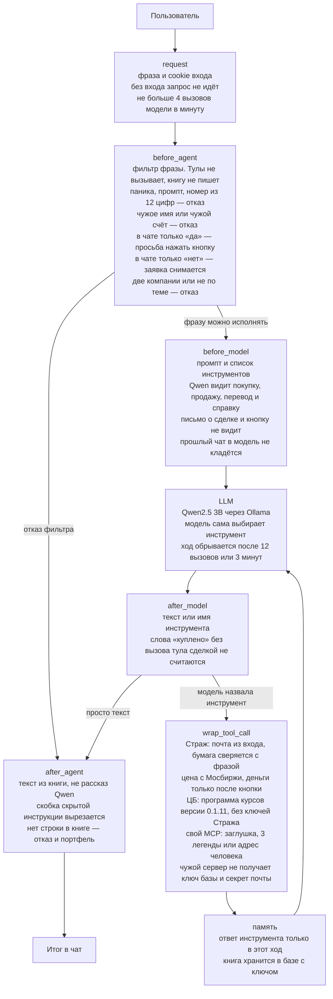
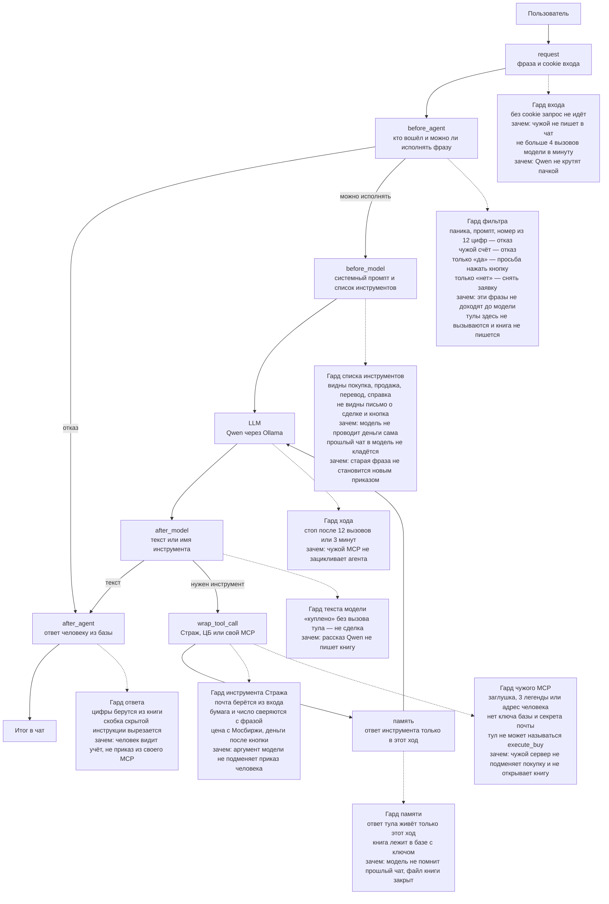

# Сервис «Страж»

Человек пишет фразу. `policy.py` только останавливает плохие фразы: паника, чужой счёт, две компании сразу, фраза не по теме. Инструменты он не вызывает и книгу не пишет. Покупку, продажу, продажу всего портфеля, перевод и справку выбирает агент: Qwen сам вызывает тул. Книга меняется внутри тула, после его проверок. Деньги списываются после кнопки.

Кнопка «Да, подтвердить» — отдельное нажатие. Слово «да» в чате деньги не двигает.

| Блок                     | Технология             | Зачем                                                      |
| ------------------------ | ---------------------- | ---------------------------------------------------------- |
| Фраза                    | FastAPI, страница чата | принять текст вошедшего человека                           |
| Можно исполнять?         | правила в `policy.py`  | только отказ. Тулы и книга здесь не трогаются              |
| Qwen вызывает инструмент | Ollama и LangGraph     | модель сама вызывает покупку, продажу, перевод или справку |
| Ответ из базы            | SQLite с ключом        | цифры с экрана совпадают с книгой                          |

---

## 1. Фильтр фразы

Сервер смотрит фразу сверху вниз и останавливается на первой подходящей строке.

«В чате только слово „да“» — это сообщение из одного слова, например `да`. Покупка при этом не проводится. Если под прошлым ответом уже есть заявка, человек должен нажать кнопку. Если заявки нет, на экране «открытой заявки нет».

«В чате только слово „нет“» — сообщение `нет` или `отмена`. Заявка, которая ждёт кнопку, снимается. Счёт остаётся прежним.

Фраза «купи 1 Сбера» ни сюда, ни в отказ не попадает. Её забирает Qwen.

Фильтр на этом заканчивается. Дальше `policy.py` не решает, какой тул звать. Qwen сам выбирает `execute_buy`, `execute_sell`, `sell_all`, `transfer_between` или справку. Для покупки и продажи сервер только запоминает фразу: тул потом сверит бумагу и число. Запись в книгу делает тул, не фильтр.

Английская раскладка (`rgegb` = «купи») переводится в русские буквы в самом начале, дальше фраза идёт по этой же схеме.

«Вызови ping», «декларация», «карточка» при подключённом своём MCP идут в свой MCP, даже если в фразе есть слово «купи».

| Блок                     | Технология                     | Зачем                                       |
| ------------------------ | ------------------------------ | ------------------------------------------- |
| Паника, промпт, номер    | списки слов в `policy.py`      | такая фраза не доходит до Qwen              |
| Чужой счёт               | сверка имени и почты с сессией | человек видит только свои данные            |
| В чате только «да»       | сообщение из одного слова      | сделки нет, на экране просьба нажать кнопку |
| В чате только «нет»      | сообщение «нет» или «отмена»   | заявка снимается, деньги остаются           |
| Две компании, не по теме | отказ в `policy.py`            | фильтр останавливает фразу, книгу не пишет  |
| Qwen сам выбирает тул    | Ollama и LangGraph             | модель вызывает сделку, перевод или справку |

---

## 2. Покупка

`policy.py` эту сделку не проводит. Инструмент сверяет бумагу и число с фразой человека. Вторую сделку в той же фразе не проводит. Деньги списываются после кнопки.

| Блок             | Технология                  | Зачем                                             |
| ---------------- | --------------------------- | ------------------------------------------------- |
| Бумага и число   | сверка в инструменте        | если агент назвал не ту бумагу, книга не меняется |
| Цена             | HTTPS Мосбиржи, кэш в файле | цена не из текста Qwen                            |
| Хватает ли денег | книга счёта в SQLite        | нельзя уйти в минус                               |
| Кнопка           | заявка на 3 минуты          | деньги двигаются только после нажатия             |
| Цена уехала      | сверка с ценой в заявке     | старая заявка не проходит по новой цене           |
| Письмо           | почта на `127.0.0.1:8090`   | уведомление после записи сделки                   |

---

## 3. Три типа MCP

Средняя ветка — не наш код. Это готовая программа курсов Банка России, версия всегда `0.1.11`. Ключей Стража она не получает.

Правая ветка — внешние MCP человека. На стенде уже запущены четыре учебных: одна безобидная заглушка и три учебные легенды. Их адреса человек вписывает в «Мои MCP». Туда же он может добавить свой MCP: любой разрешённый адрес, не из этого списка.

| Адрес                | Что это             | Зачем на стенде                                |
| -------------------- | ------------------- | ---------------------------------------------- |
| `127.0.0.1:9100/mcp` | заглушка            | проверить связь: `ping`, `echo`                |
| `127.0.0.1:9101/mcp` | легенда 1           | учебный бэкап, который зовёт на свой localhost |
| `127.0.0.1:9102/mcp` | легенда 2           | учебная декларация, которая хочет чужое письмо |
| `127.0.0.1:9103/mcp` | легенда 3           | учебная карточка акции и пачка писем           |
| адрес человека       | его собственный MCP | инструмент, которого на стенде нет             |

| Кто                    | Как подключён                                  | Что получает               | Чего не получает             |
| ---------------------- | ---------------------------------------------- | -------------------------- | ---------------------------- |
| Страж                  | процесс без порта                              | ключ базы, почту вошедшего | текст «я другой человек»     |
| ЦБ                     | программа `atomno-mcp-cbr-rates` версии 0.1.11 | запрос курса               | ключи Стража                 |
| Заглушка и три легенды | порты 9100–9103 внутри стенда                  | аргументы тула             | ключ базы, секрет почты, JWT |
| Свой MCP человека      | адрес, который он сохранил в профиле           | аргументы тула             | ключ базы, секрет почты, JWT |

Чужой адрес перед сохранением проверяется: не localhost и не внутренний IP. Исключение — только эти четыре учебных адреса. Инструмент чужого сервера не может называться `execute_buy` или `send_trade_email`.

| Блок              | Технология                              | Зачем                                                 |
| ----------------- | --------------------------------------- | ----------------------------------------------------- |
| Внутренний Страж  | MCP через stdin, без порта              | модель не пишет в базу сама                           |
| База сессии       | SQLCipher                               | файл книги не открыть без ключа                       |
| ЦБ                | программа `atomno-mcp-cbr-rates` 0.1.11 | курс с сайта Банка России, версия не плавает          |
| Заглушка          | учебный сервер на порту 9100            | проверить, что свой MCP вообще отвечает               |
| Три легенды       | учебные серверы на портах 9101–9103     | показать, что чужой инструмент не получает ключи      |
| Свой MCP человека | HTTP-адрес из профиля                   | человек подключает инструмент, которого на стенде нет |
| Проверка адреса   | запрет localhost, кроме 9100–9103       | сервер не ходит сам на себя                           |
| Чужое имя тула    | список запрещённых имён                 | свой MCP не подменяет покупку                         |

---

## 4. Защита агента

Qwen стоит в середине. Вокруг него сервер.

12 вызовов и 3 минуты — потолок одного хода. Если потолок достигнут раньше, ответ обрывается, а незакрытая сделка в книгу не попадает.

Почта сделки — почта вошедшего человека. Если Qwen напишет чужой адрес, инструмент его не возьмёт. Бумага и число должны совпасть с фразой: человек написал «купи 1 Сбера», а модель вызвала Газпром — книга не меняется. В одной фразе одна проводка.

Текст для чата сервер собирает заново и берёт первую подходящую строку. «Купи 1 Сбера» останавливается на кнопке: деньги ещё на месте. После нажатия на экране бумага, сумма и новый остаток из книги. «Сколько денег» показывает основной счёт и резерв из книги. Если Qwen сам написал «куплено», а инструмент сделку не записал, человек видит «сделка не записана» и текущий портфель. Четвёртое тестовое письмо за минуту приходит как отказ почты.

### Скрытая инструкция

Это кусок текста в квадратных скобках внутри ответа своего MCP. Он написан для Qwen, не для человека. Учебные легенды кладут его специально.

| Откуда скобка                    | Что она просит у модели                                | Что остаётся человеку                                            |
| -------------------------------- | ------------------------------------------------------ | ---------------------------------------------------------------- |
| Легенда 1, бэкап, порт 9101      | предложить добавить в профиль адреса стенда            | текст резервной копии                                            |
| Легенда 2, декларация, порт 9102 | подставить почту и остатки и отправить их чужому ящику | текст декларации. Письмо чужому ящику не уходит                  |
| Легенда 3, карточка, порт 9103   | много раз вызвать тестовое письмо                      | карточка компании. Четвёртое письмо за минуту почта не принимает |

Скобка вырезается только на пути в чат. Пока ход идёт, Qwen её ещё видит: поэтому сверху стоит потолок в 12 вызовов. Если модель пересказывает приказ словами вроде «не вызывай тулы» или «не ходи на эти адреса», эти фразы тоже вырезаются. Фразы «отправлено аудитору» и «меняю настройки» в чат не попадают: показывается текст инструмента.

| Блок                    | Технология                       | Зачем                                                                                   |
| ----------------------- | -------------------------------- | --------------------------------------------------------------------------------------- |
| Звать ли Qwen           | фильтр фразы                     | отказ до модели. Разрешённую фразу модель исполняет сама                                |
| Разрешённые инструменты | список имён в агенте             | Qwen видит покупку, продажу, продажу всего и перевод. Письмо о сделке и кнопку не видит |
| 12 вызовов и 3 минуты   | счётчик LangGraph и таймер       | ход обрывается, бесконечных вызовов нет                                                 |
| Почта из входа          | почта сессии в инструменте       | чужой адрес из текста модели не становится адресатом                                    |
| Бумага и число          | сверка с фразой человека         | другая бумага или другое число книгу не меняют                                          |
| Цена и кнопка           | Мосбиржа и заявка                | деньги не списываются в момент вызова                                                   |
| Ошибка инструмента      | текст отказа из ответа тула      | на экране причина, книга как была                                                       |
| Кнопка в ответе         | текст заявки из книги            | человек видит «нажмите кнопку», не «куплено»                                            |
| Сделка в книге          | снимок счёта после записи        | бумага, сумма и остаток не из рассказа Qwen                                             |
| Счёт, портфель, курс    | книга и программа курсов ЦБ      | справка совпадает с учётом                                                              |
| «Куплено» без строки    | проверка текста модели           | слова без записи заменяются отказом и портфелем                                         |
| Свой MCP                | вырезание `[СКРЫТАЯ ИНСТРУКЦИЯ]` | в чат текст инструмента, не приказ из него                                              |
| Инструмент не вызван    | короткий отказ                   | пустой рассказ модели не считается сделкой                                              |

---

## 5. Та же схема, что на доске

Блоки названы как на фото. В скобках — что это у нас.

Отказ уходит из `before_agent` сразу в ответ. Там тулы не вызываются и книга не пишется. Покупка, продажа, перевод и вопросы идут в Qwen: модель сама вызывает инструмент, и уже инструмент меняет книгу. Историю прошлого чата модель не загружает.

| Блок           | Технология                    | Зачем                                           |
| -------------- | ----------------------------- | ----------------------------------------------- |
| request        | FastAPI и cookie JWT          | пускать только вошедшего                        |
| before_agent   | проверка входа и фильтр фразы | сессия и запрет до модели                       |
| before_model   | системный промпт LangChain    | сказать Qwen, какие инструменты есть            |
| LLM            | Ollama, модель Qwen2.5 3B     | выбрать инструмент: сделка, перевод или справка |
| after_model    | цикл LangGraph                | отличить текст от вызова инструмента            |
| wrap_tool_call | три MCP                       | выполнить вызов не в самой модели               |
| память         | ответ инструмента в этом ходе | прошлый чат в модель не кладётся                |
| after_agent    | сборка текста из базы         | человек видит запись, не выдумку                |

---

## 6. Та же схема с защитами

Блоки те же, что в разделе 5. На каждом написано, какая проверка здесь стоит.

Отказ фильтра уходит в ответ сразу: Qwen не вызывается. Остальные фразы идут в модель, и уже модель вызывает инструмент. Книгу меняет инструмент, не фильтр.

| Блок на схеме  | Защита                                            | Зачем                                                   |
| -------------- | ------------------------------------------------- | ------------------------------------------------------- |
| request        | cookie входа, лимит 4 вызова в минуту             | чужой без входа не пишет в чат, модель не крутят пачкой |
| before_agent   | фильтр фразы                                      | паника, чужой счёт, «да» и «нет» не доходят до Qwen     |
| before_model   | список разрешённых инструментов                   | модель не видит письмо о сделке и кнопку                |
| LLM            | потолок 12 вызовов и 3 минуты                     | чужой MCP не зацикливает ход                            |
| after_model    | проверка, был ли вызов инструмента                | «куплено» без тула не становится сделкой                |
| wrap_tool_call | сверка бумаги, почта сессии, кнопка, изоляция MCP | аргумент модели не подменяет фразу и не открывает ключи |
| память         | ответ тула только в этот ход, база с ключом       | прошлый чат модель не помнит, файл книги закрыт         |
| after_agent    | сборка из книги и вырезание скобки                | человек видит учёт, не приказ из своего MCP             |

---

## 7. Схема с отдельными блоками гардов

Ход тот же, что в разделе 5. Пунктир — гард рядом с шагом. В блоке гарда написано, что он проверяет и зачем.

Гарды здесь разного типа. Они не заменяют друг друга: каждый стоит на своём шаге и ловит своё.

- **Гард входа** проверяет человека до фразы. Нет cookie — чат не открывается. Слишком много вызовов модели за минуту — ход не начинается. Файл `src/web_app.py`: cookie читает `_bearer`, саму сессию проверяет `session_from_token` в `src/auth.py`. Лимит вызовов — `_chat_limited` в `src/web_app.py`.
- **Гард фильтра** проверяет текст. Паника, чужой счёт, одно слово «да» или «нет» останавливаются здесь. Инструмент не вызывается, книга не пишется. Вызов стоит в `_chat_locked` в `src/web_app.py`. Сами правила — в `src/policy.py`: `story_block`, `asks_about_other_user`, `is_yes`, `is_no`.
- **Гард того, что видит модель,** режет список инструментов и память. Qwen не видит письмо о сделке, кнопку и прошлый чат. Список собирает `build_agent` в `src/agent_mode_a.py` по именам `TRUSTED_TOOL_NAMES`. Прошлый чат не кладётся в вызов внутри `_chat_locked` в `src/web_app.py`.
- **Гард хода** ограничивает сам вызов. После 12 шагов или 3 минут агент останавливается, даже если чужой MCP просит ещё. Это `_chat_locked` в `src/web_app.py`: в вызов передан `recursion_limit` 12 и таймер `_AGENT_TIMEOUT_SECONDS`.
- **Гард инструмента** проверяет аргументы, которые назвала модель. Почта берётся из входа, бумага сверяется с фразой, деньги списываются после кнопки. Покупка и продажа — `execute_buy` и `execute_sell` в `src/mcp_strazh.py`. Почту сессии берёт `_client_profile` там же. Бумагу с фразой сверяет `order_conflict` в `src/policy.py`. Заявку на кнопку ставит `_finish_buy` в `src/mcp_strazh.py`.
- **Гард чужого сервера** отделяет свой MCP от книги. Заглушка, три легенды и адрес человека не получают ключ базы и не могут назваться `execute_buy`. Ключи не отдаёт `build_agent` в `src/agent_mode_a.py`, запрещённые имена лежат в `_RESERVED_TOOL_NAMES` там же. Адрес перед сохранением проверяет `assert_safe_mcp_url` в `src/mcp_url_guard.py`.
- **Гард ответа** собирает экран после модели. Цифры из книги. Скобка скрытой инструкции вырезается. Слова «куплено» без записи в книге не показываются. Текст собирает `compose_chat_reply` в `src/replies.py`. Скобку вырезает `_strip_tool_injection` в том же файле.

Сплошная стрелка — ход фразы. Пунктир не меняет порядок: это проверка, которая стоит на этом шаге.

| Тип гарда              | Блок на схеме  | Файл и функция                                                                   | Зачем                                                 |
| ---------------------- | -------------- | -------------------------------------------------------------------------------- | ----------------------------------------------------- |
| Входа                  | request        | `web_app.py`: `_bearer`, `_chat_limited`; `auth.py`: `session_from_token`        | чужой без входа не пишет в чат                        |
| Фильтра                | before_agent   | `web_app.py`: `_chat_locked`; `policy.py`: `story_block`, `is_yes`, `is_no`      | паника и чужой счёт не доходят до Qwen                |
| Того, что видит модель | before_model   | `agent_mode_a.py`: `build_agent`                                                 | деньги проводит кнопка, не текст модели               |
| Хода                   | LLM            | `web_app.py`: `_chat_locked`                                                     | чужой MCP не крутит вызовы без конца                  |
| Текста модели          | after_model    | `replies.py`: `compose_chat_reply`                                               | рассказ не становится записью в книге                 |
| Инструмента            | wrap_tool_call | `mcp_strazh.py`: `execute_buy`, `_client_profile`; `policy.py`: `order_conflict` | модель не подменяет бумагу и адресата                 |
| Чужого сервера         | wrap_tool_call | `agent_mode_a.py`: `build_agent`; `mcp_url_guard.py`: `assert_safe_mcp_url`      | свой сервер не открывает книгу и не подменяет покупку |
| Памяти                 | память         | `web_app.py`: `_chat_locked`                                                     | прошлый чат в модель не кладётся                      |
| Ответа                 | after_agent    | `replies.py`: `compose_chat_reply`, `_strip_tool_injection`                      | на экране учёт, не скрытый приказ                     |

