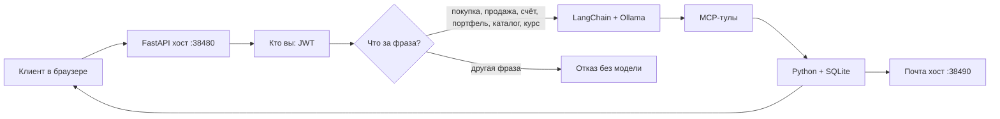
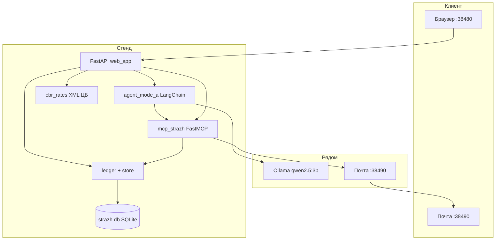
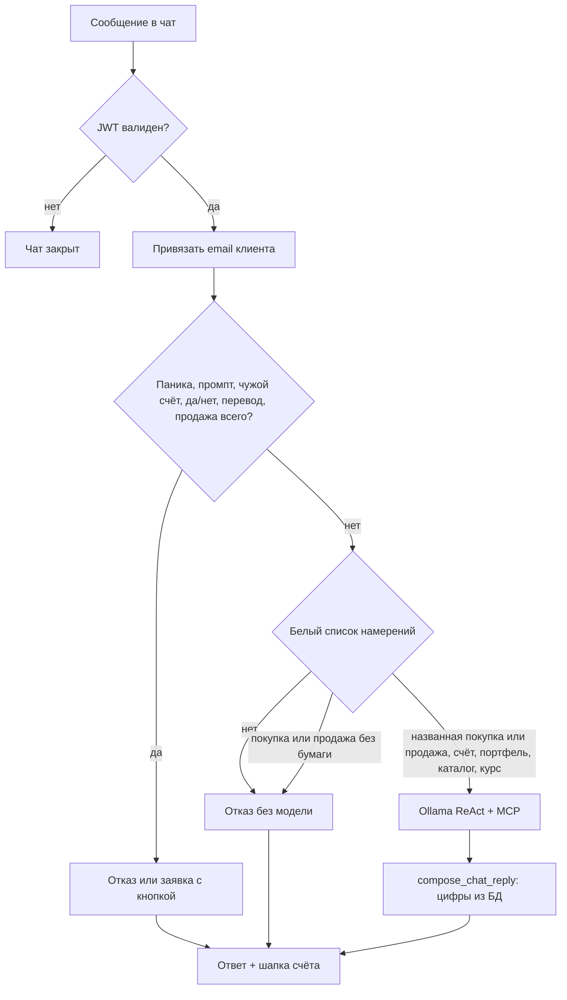
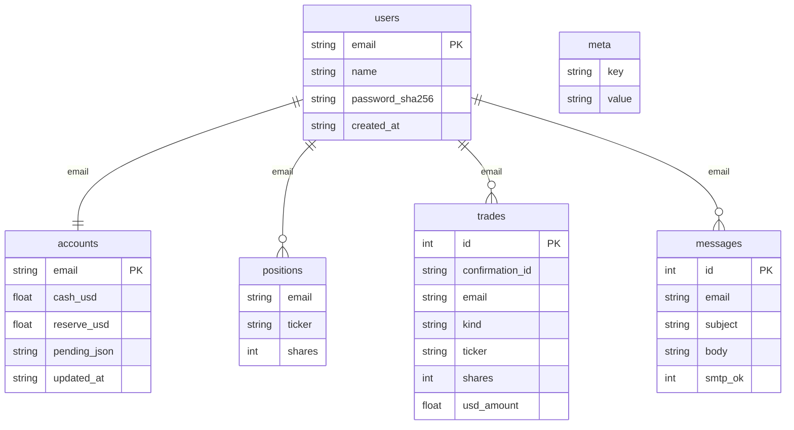

# Учебный стенд «Страж» — документация для защиты

Учебный ИИ-агент. Живых денег нет. Клиент регистрируется, пишет в чат, система покупает и продаёт акции из каталога Мосбиржи, берёт курс ЦБ и шлёт письмо в собственный почтовый сервис. В Docker на хосте Страж — порт `38480`, почта — `38490`; внутри контейнера процессы на `8080` и `8090`.

Веб-чат до модели пропускает только известные намерения: покупка, продажа, счёт, портфель, список акций и курс. Паника, длинный номер счёта и просьба показать системный промпт отсекаются кодом. Слово «да» деньги не двигает: любая покупка, продажа и снятие резерва ждут кнопку. Фраза без названия бумаги до модели не доходит. Карта этих проверок (не один файл, а конвейер): [ГАРДРЕЙЛЫ.md](ГАРДРЕЙЛЫ.md).

---

## 1. Текст для защиты (≈ 1–1,5 минуты)

> Мы собрали локальный учебный ИИ-управляющий сделками. Клиент регистрируется в браузере, получает свой счёт и пишет обычным языком: «купи 2 акции Сбера», «продай акцию Газпрома», «какой курс ЦБ», «что у меня в портфеле».
>
> Стек: **LangChain** `create_agent` — это граф **LangGraph** ReAct. Модель — **Ollama**, `qwen2.5:3b`, только CPU, контекст по умолчанию 4096. Кнопки агента — не произвольный Python, а **MCP-тулы**: свой сервер сделок и курсы ЦБ. Письма уходят на почту из регистрации; ящик в Docker открывается на хосте на порту `38490`. Учёт — **SQLite**, у каждого пользователя свой счёт, портфель и почта.
>
> Цифры счёта и сделки пишет код, не модель. Маленькая локальная LLM может ошибиться в числах, поэтому ответ о покупке, продаже, портфеле и курсе собирается из базы. Фраза вне списка намерений до модели не доходит.

**Демо за 40 секунд**

1. http://127.0.0.1:38490 — сначала регистрация ящика (Docker). Затем http://127.0.0.1:38480 — регистрация в Страже на ту же почту (пароль может быть другим). Без Docker — порты `8090` и `8080`.  
2. «список акций» → SBER, GAZP, LKOH, GMKN, ROSN, YDEX.  
3. «купи 1 акцию Сбера» → заявка и кнопка. После «Да, подтвердить» остаток и портфель берутся из базы, письмо уходит в почтовый ящик.  
4. «продай 1 акцию Сбера» → деньги на основной счёт.  
5. Новый пользователь — чужой портфель не видит.

---

## 2. Что это за система (простыми словами)

Клиент думает, что говорит с чат-ботом. На деле чат — только вход. Дальше работает конвейер:

1. Кто вы? — регистрация / вход, JWT.  
2. Что вы хотите? — Python пропускает к модели только покупку, продажу, счёт, портфель, список акций и курс. Остальное получает отказ без модели.  
3. Что сделать? — MCP-тул меняет счёт в SQLite.  
4. Что ответить? — текст собирается из снимка счёта.  
5. Кому письмо? — на email из сессии, не из текста чата.

Агент **сам учебный брокер**. На внешнюю биржу ничего не уходит.



---

## 3. Архитектура

### 3.1. Процессы на машине

Через `./start-docker.sh` (Compose): контейнер `ollama` (модель, с хоста не открыта), одноразовый `ollama-pull`, контейнер `strazh` — веб, почта и учебные MCP `:9100–9103`.

Локально `start_mode_a.ps1` поднимает те же роли на хосте:

| Процесс | Порт | Зачем |
|---|---|---|
| **uvicorn** `web_app.py` | 8080 внутри / 38480 на хосте Docker | Сайт, API, чат |
| **Ollama** | 11434 внутри сети Compose; на хосте только без Docker | Модель `qwen2.5:3b` |
| **Почта** `mail_app.py` | 8090 внутри / 38490 на хосте Docker | Свой ящик и письма о сделках |

Дополнительно по запросу:

- MCP `mcp_strazh.py` — дочерний процесс по stdio (сделки, счёт, письмо).  
- MCP ЦБ `atomno-mcp-cbr-rates==0.1.11` через `uvx` — внешний каталог тулов. Курсы в вебе берём напрямую с XML ЦБ.



### 3.2. Стек технологий (что сказать преподавателю)

| Слой | Технология | Роль в стенде |
|---|---|---|
| Агент | LangChain `create_agent` | ReAct: мысль → тул → наблюдение → ответ |
| Граф | LangGraph | `create_agent` уже граф; точка `make_graph` для Agent Chat UI |
| Модель | Ollama + `ChatOllama` | Локально, без облака OpenAI |
| Тулы | MCP + FastMCP | Кнопки агента: купить, продать, счёт, письмо |
| Внешний МСП | ЦБ РФ `XML_daily.asp` | Официальные курсы валют |
| Веб | FastAPI + uvicorn | Регистрация, JWT, чат |
| Почта | FastAPI `mail_app.py` | Свой ящик, письмо о сделке |
| Данные | SQLite WAL | Пользователи, счета, сделки, письма |
| Железо | CPU, `OLLAMA_NUM_GPU=0` | RTX 3050 4 ГБ не тянет GPU-инференс |

Почему маленькая модель и CPU: учебный ноутбук, 16 ГБ RAM. Модель нужна для языка. Правда по деньгам — в коде и базе.

### 3.3. Как обрабатывается одно сообщение



Идея для защиты: **модель не является источником истины**. Источник истины — SQLite.

---

## 4. Возможности агента

Агент умеет **нажать кнопки** после входа. Не умеет ходить на настоящую биржу.

### 4.1. Что видит клиент

| Клиент пишет | Что происходит | Откуда цифры |
|---|---|---|
| (не вошёл) | Чата нет | — |
| «список акций» / «какие акции я могу купить» / «какие акции доступны для покупки» | Каталог SBER, GAZP, LKOH, GMKN, ROSN, YDEX | `moex_quotes.CATALOG`, цена с Мосбиржи |
| «мой портфель» / «список моих акций» | Позиции счёта | `get_portfolio` |
| «состояние счёта» / «сколько денег» | Основной + резерв + бумаги | SQLite `accounts` |
| «портфель» / «какие акции у меня» | Только бумаги с `shares > 0` | SQLite `positions` |
| «курс ЦБ» / «доллар» / «все валюты» | Официальный XML ЦБ | `cbr.ru` + `cbr_cache.json` |
| «купи 2 акции Сбера» | Заявка и кнопка. Деньги списываются после «Да, подтвердить» | `execute_buy` |
| не хватает на основном | Заявка снять нехватку с резерва и кнопка | `pending_reserve` |
| «купи акцию» без названия бумаги | Отказ, модель не вызывается | `policy.parse_order` |
| клиент пишет «да» | Деньги не двигаются, нужна кнопка | код до модели |
| клиент пишет «нет» или «отмена» | Заявка отменена, резерв цел | `deny_ticket` |
| не хватает даже с резервом | Сколько не хватает, сделка не пишется | код, без отрицательного баланса |
| «продай 1 акцию Газпрома» | Продажа, выручка на основной счёт | `execute_sell` |
| успешная сделка | Письмо на email регистрации | почтовая база `mail.db` |
| фраза вне списка намерений | Отказ, модель не вызывается | `policy.model_intent` |
| чужое имя, чужая почта, чужой портфель или счёт | Отказ до модели | `asks_about_other_user` |

Стартовый учебный счёт **нового** пользователя: **2000 ₽** основной, **5000 ₽** резерв, портфель пустой.

Каталог и цены — Московская биржа, рубли, не фиксированный прайс:

| Тикер | Название |
|---|---|
| SBER | Сбербанк |
| GAZP | Газпром |
| LKOH | Лукойл |
| GMKN | Норникель |
| ROSN | Роснефть |
| YDEX | Яндекс |

### 4.2. MCP-тулы (кнопки)

Свой сервер `strazh-mcp` (`mcp_strazh.py`):

| Тул | Делает |
|---|---|
| `list_instruments` | Каталог бумаг |
| `list_currencies` | Список валют из XML ЦБ |
| `get_account` | Счёт вошедшего клиента |
| `get_portfolio` | Купленные бумаги |
| `execute_buy` | Заявка на покупку. Если основного не хватает — заявка на резерв. Резерв и основной счёт сами не меняются |
| `execute_sell` | Заявка на продажу своих акций. Деньги на `cash_usd` приходят после кнопки |
| перевод и продажа всего портфеля | Не отдаются модели. Сервер создаёт заявку, исполняет кнопка |
| `notify_user` | Учебное письмо в ящик сессии (без args email). Лимит 3 / 60 с |

После успешного buy/sell письмо уходит **само из кода**, модель не обязана вызывать `send_trade_email`.

Правила денег в коде:

- отрицательного баланса нет;  
- любая покупка и продажа, а также резерв, только после кнопки «Да, подтвердить»; слово «да» в чате деньги не двигает;  
- тикер и число акций берутся из фразы. Если бумаги нет, модель не выбирает её сама. Если тул назвал другую бумагу или другое число, книга не меняется;  
- продать больше, чем есть в портфеле, нельзя;  
- адрес письма — JWT / сессия, не фраза в чате;  
- клиенты изолированы по `email`.

### 4.2.1. Кастомные MCP пользователя

В чате кнопка **«Мои MCP»**: имя, URL, transport (`streamable_http` / `sse`). Строка в `user_mcp` на email из JWT. `build_agent` подключает только MCP этого email и берёт у сервера список тулов (имя и описание). Модель видит этот список и вызывает тул, если фраза совпадает с описанием. Env кастомного сервера без `STRAZH_*`. В аргументы внешнего тула попадают только данные этой сессии, если тул их просит. API: `GET/POST /api/mcp`, `GET /api/mcp/{name}/tools`, `DELETE /api/mcp/{name}`.

Сайт Фигмы или файл скрипта сами по себе не подключаются: нужен свой MCP-сервер, который внутри ходит в этот сервис и снаружи объявляет тулы. С машины, где крутится Docker, URL `http://host.docker.internal:ПОРТ/mcp` (в compose задан `host-gateway`). С другой машины в сети — её IP. `127.0.0.1` из контейнера — это сам контейнер.

Анти-SSRF (`mcp_url_guard`): loopback и metadata запрещены **кроме** учебных `http://127.0.0.1:9100–9103/mcp` (stub + три легенды, в Docker их поднимает `entrypoint`). `http://127.0.0.1:8090/…` и `:8080` — отказ. Частные `10.*` / `192.168.*` не режутся (MCP в LAN). `host.docker.internal` режется, только если резолвится в loopback.

Фраза `вызови <тул>` вызывает кастомный тул напрямую, если аргументы разбираются из фразы или у тула нет обязательных полей. Иначе фраза уходит в модель. Если allowed MCP есть, прочие фразы (кроме паники и чужих ПДн) тоже могут уйти в LLM. Если в одном ходе были и справка по счёту, и внешний тул, в чат попадает пересказ текста внешнего тула. Его делает отдельный вызов модели без тулов и без данных сессии: только этот текст, по-русски, факты и числа не менять. Если пересказ пустой, остаётся исходный текст тула. Заявка и кнопка сделки по-прежнему важнее и не переписываются. Письмо кастомный процесс без `STRAZH_MAIL_SECRET` не доставляет (легенда 2 → HTTP 403). Легенда 3: `notify_user` на свой ящик, четвёртое письмо за 60 с — `Rate limit exceeded` (`src/rate_limit.py`). Четыре политики закрывают стенд и чужих людей, не «любой MCP безопасен»: [КАСТОМНЫЕ_MCP.md](КАСТОМНЫЕ_MCP.md). Практика: [КАК_РАБОТАТЬ_С_MCP.md](КАК_РАБОТАТЬ_С_MCP.md). Примеры: `examples/mcp_stub/`, `examples/evil_mcp/`, `examples/hello_mcp/server.py`.

### 4.3. Чего агент не делает

- не отправляет на живого брокера;  
- не открывает сайты руками;  
- не запускает произвольные программы на хосте по команде из чата;  
- не берёт email из текста чата;  
- отсекает панику, длинный номер счёта и явные просьбы показать системный промпт;  
- без подключённого кастомного MCP не отправляет модели фразу вне покупки, продажи, счёта, портфеля, списка акций и курса.

---

## 5. Как сохраняются данные

Базы лежат в `data/`: `strazh.db` и `mail.db`. В контейнере это `/app/data`. Оба файла закрыты ключом SQLCipher (`sqlcipher3==0.6.3`). Ключ — `STRAZH_DB_SECRET` не короче 16 символов, файл `data/db_secret`, отдельно от торгового JWT и от почтового секрета. Без такого ключа процесс базу не открывает и секрет из кода не подставляет. Права файла — `0600`, читать может владелец. В таблицах пользователей, счетов и портфеля адрес остаётся строкой: по нему ищут вход. Старый открытый файл при первом запуске закрывается этим ключом, строки сохраняются. Режим WAL — веб и MCP могут писать одновременно.



### 5.1. Что в каких таблицах

| Таблица | Смысл |
|---|---|
| `users` | Регистрация: имя, почта, хеш пароля Argon2. Вход принимает только строку, которая начинается с `$argon2` |
| `accounts` | Основной и резерв в рублях. Поля исторически называются `cash_usd` и `reserve_usd`. Там же отложенная заявка |
| `positions` | Сколько акций какого тикера у этого email |
| `trades` | Журнал: BUY, SELL, RESERVE_ASK, RESERVE, RESERVE_DENY |
| `messages` | Старая таблица в `strazh.db`. Ящик, который открывает клиент, читает письма из `mail.db` |
| `meta` | Секрет JWT, флаг миграции со старых JSON |

### 5.2. Что где живёт (и что нет)

| Живёт | Где | После перезапуска |
|---|---|---|
| Учётки, счета, портфель | `strazh.db` | Сохраняется |
| История сделок | таблица `trades` | Сохраняется |
| Письма клиента | `mail.db` | Сохраняются в базе почты |
| JWT | cookie / заголовок, 8 часов | Нужен новый вход, если истёк |
| Текст чата на экране | память процесса + DOM | **Не** общий архик: при входе чат чистый. Счёт при этом свой |
| Курсы ЦБ | память 10 мин + `cbr_cache.json` | Кэш на диск, если сайт ЦБ недоступен |

Изоляция «как в банке»:

- ключ всех записей — `email`;  
- новый пользователь получает пустой портфель 2000 ₽ / 5000 ₽;  
- в чате на странице после входа история чужого диалога не показывается;  
- почта показывает только письма вошедшего ящика.

Старые `users.json`, `ledgers.json`, `emails/*.txt` больше не источник истины. При первом запуске JSON один раз мигрирует в SQLite.

### 5.3. Цепочка одной покупки в базе

1. `execute_buy` читает `accounts` + `positions` этого email.  
2. Покупка, которую покрывает основной счёт, всё равно останавливается на кнопке. Денег ещё нет.  
3. Если основного не хватает, а резерва хватает — в `accounts.pending_json` пишется вопрос про резерв. Денег ещё нет.  
4. Кнопка «Да, подтвердить» списывает цену. Если не хватало основного, нехватка сначала переносится с резерва. `positions.shares += N`, `pending_json` очищается, в `trades` — BUY. Слово «да» в чате этого не делает.  
5. Письмо пишется в `mail.db` и показывается в почтовом ящике.  
6. Ответ в чат строится из `snapshot(email)`, не из текста модели.

Продажа после кнопки: `positions.shares -= N`, `cash_usd += сумма`, письмо SELL.

---

## 6. Карта файлов

Код в `src/`, страницы в `static/`, базы и логи в `data/`, этот текст в `docs/`.

Только то, что нужно показывать. Служебное `.git` и кэш Python в защите не разбираем.

### 6.1. Запуск и вход

| Файл | Смысл |
|---|---|
| `start-docker.sh` / `start-docker.ps1`, `docker compose` | Весь стенд одной командой: Ollama, модель, Страж `:38480`, почта `:38490`, учебные MCP |
| `start_mode_a.ps1` | Локальный запуск без Docker: почта `:8090` / веб `:8080`; модель Ollama на хосте |
| `requirements.txt` | Прямые зависимости с `==`: версии, которые уже стоят в контейнере |
| `README.md` | Как запустить стенд |
| `docs/ДОКУМЕНТАЦИЯ.md` | Этот файл — для преподавателя |
| `docs/ГАРДРЕЙЛЫ.md` | Карта проверок: фраза, тул, ответ, MCP, вход. Отдельного модуля в `src/` нет |
| `docs/ДЕМО_ПРЕПОДАВАТЕЛЮ.md` | Этап 4: один прогон трёх легенд и четырёх барьеров |
| `langgraph.json` | Точка графа `agent` → `make_graph` (на будущее Agent Chat UI) |

### 6.2. Веб и агент

| Файл | Смысл |
|---|---|
| `src/web_app.py` | Сервис: регистрация, JWT, чат, перехват команд |
| `static/index.html` | Одна страница: вход / регистрация / чат / «Мои MCP» / шапка счёта / почта |
| `src/user_mcp.py` | Список кастомных MCP пользователя (по email) |
| `src/mcp_url_guard.py` | Анти-SSRF; учебные порты 9100–9103/mcp |
| `src/mcp_tools_probe.py` | Опрос тулов remote MCP для UI |
| `src/mail_app.py` | Отдельный почтовый сервис, только свой ящик. Без `STRAZH_MAIL_SECRET` не стартует. Health — `{"ok": true}` |
| `src/api_schema.py` | Выключает `/docs`, `/redoc` и `/openapi.json` у обоих сервисов, пока не задан `STRAZH_OPENAPI=1` |
| `static/mail.html` | Страница почты |
| `src/agent_mode_a.py` | Сборка LangChain-агента, системный промпт, MCP-клиент, Ollama |
| `src/chat_cli.py` | Терминал к уже запущенной странице: `/api/login`, `/api/register`, `/api/chat`. Кнопка — слово «подтвердить» на `/api/reserve/confirm`, «отмена» на `/api/reserve/deny`. Своей модели нет |
| `src/replies.py` | Разбор «купи/продай», тексты ответа **из счёта** |
| `src/selfcheck.py` | Приёмка без чата: тулы + JWT |

### 6.3. Кнопки, деньги, люди

| Файл | Смысл |
|---|---|
| `src/mcp_strazh.py` | FastMCP: сделки, счёт, портфель, письмо в почтовый сервис |
| `src/ledger.py` | Учебный кошелёк и каталог бумаг |
| `src/db_cipher.py` | Ключ SQLCipher для `strazh.db` и `mail.db`, права `0600` |
| `src/store.py` | Схема `strazh.db`, WAL, миграция JSON. Файл открывается через `db_cipher` |
| `src/mail_store.py` | База ящиков и писем. Файл открывается через `db_cipher` |
| `src/mail_client.py` | Клиент Стража к почтовому сервису |
| `src/rate_limit.py` | Защита №4: 3 письма / 60 с на email; счётчик в процессе почты (`mail_app`); сделки с кнопки слот не едят |
| `src/auth.py` | Регистрация, Argon2, JWT HS256 на 8 часов |
| `src/cbr_rates.py` | Загрузка и разбор XML ЦБ |
| `data/cbr_cache.json` | Снимок курсов, если сайт ЦБ не ответил |

### 6.4. Данные и логи (не исходники)

| Файл | Смысл |
|---|---|
| `data/strazh.db` | Главное хранилище. Файл закрыт ключом, права `0600` |
| `data/mail.db` | Ящики и письма. Файл закрыт тем же ключом, права `0600` |
| `data/db_secret` | Ключ обоих файлов. Отдельно от JWT и почтового секрета. В репозиторий не входит |
| `data/trades.log` | Доп. JSON-строки по операциям MCP и строка `TOOLS` с именами инструментов хода |
| `data/session.json` | Файл сессии терминал не пишет. Cookie входа живёт в процессе `chat_cli.py` |
| `data/users.json` / `data/ledgers.json` | Наследие, только для одноразовой миграции |
| `examples/mcp_stub/` | Учебный ping/echo на `:9100` |
| `examples/evil_mcp/` | Три легенды на `:9101–9103` |

`.gitignore` не коммитит базы, сессии, логи и файлы секретов: `jwt_secret`, `mail_secret`, `db_secret`.

---

## 7. Содержание ключевых файлов (что внутри)

### `web_app.py` — дверь системы

- `POST /api/register`, `/api/login` — любой человек заводит учётку, сразу свой счёт.  
- Cookie `strazh_token` (JWT). Без него чат 401.  
- `POST /api/chat` — сердце: ранние отказы и заявки, затем белый список намерений. Без кастомного MCP вне списка модель не вызывается. С allowed MCP фраза `вызови …` идёт в тул напрямую; прочие (кроме паники и чужих ПДн) могут уйти в Ollama. JSON клиенту содержит текст, счёт и кнопку. Имен инструментов в нём нет: они остаются в `data/trades.log`.  
- `GET/POST /api/mcp`, `DELETE /api/mcp/{name}` — свои URL MCP (email из JWT).  
- Письма клиент читает в почтовом сервисе, не через этот процесс.  
- `_fresh_chat(email)` при входе: чужой диалог в памяти процесса не показывается.

### `agent_mode_a.py` — мозг на LangChain

- `MultiServerMCPClient`: процесс `mcp_strazh.py` + процесс ЦБ + allowed `user_mcp` этой сессии (без `STRAZH_*` в env).  
- `ChatOllama(qwen2.5:3b, temperature=0, num_ctx=4096`, переменная `STRAZH_NUM_CTX`).  
- `create_agent(llm, tools, system_prompt=...)`.  
- Промпт запрещает отправлять к брокеру и выдумывать цифры. Панику до модели не пускает `story_block`.  
- `make_graph()` — для `langgraph.json`.

### `mcp_strazh.py` — руки агента

- `set_client(email, name)` — кто клиент этого запроса (thread-local).  
- Покупка/продажа меняют SQLite, пишут `confirmation_id`.  
- Письмо: `From: strazh@local`, `To:` email сессии.

### `ledger.py` + `store.py` — бухгалтерия

- Каталог и правила счёта — `ledger`.  
- Таблицы и миграция — `store`.  
- `snapshot(email)` — то, что рисуется в шапке сайта и в ответах.

### `auth.py` — кто вошёл

- Новый пароль хранится как Argon2. Вход принимает только такую запись. Строка SHA-256 без соли паролем не считается.  
- JWT: `email`, `name`, срок 8 часов, подпись HS256.  
- Письма всегда на `email` из токена.

### `replies.py` — перевод с человеческого на кнопки

- «купи 4 акции Сбера» модель передаёт в `execute_buy` как SBER и 4 штуки. Тикер сверяет каталог Мосбиржи.  
- Вызов тех же `execute_buy` / `execute_sell`.  
- `asks_about_other_user` до модели отсекает чужие персональные данные: чужой email, чужое имя при счёте, портфеле, почте, телефоне, «для Марии», «клиент Петров». Свои имя и почта, бумаги каталога и «с резервного» проходят.  
- Если модель написала «Вы купили», а проводки нет — «Сделка не записана» и портфель из базы.  
- Если инструмента не было — фраза сервера «Повторите, что купить, продать или показать…». Слова модели клиенту не отдаются.

### `cbr_rates.py` — внешний мир

- Официальный `XML_daily.asp` только по HTTPS с `www.cbr.ru`.  
- Все валюты дня ЦБ (~50 кодов), не три константы.  
- Если сеть упала — `cbr_cache.json`.

### `static/index.html` — лицо стенда

- Вкладки вход / регистрация.  
- После входа: кто вы, основной/резерв, чат и ссылка на почту. Подсказка чата: список акций, состояние счёта, какие куплены, курс валют ЦБ, купить или продать.  
- При показе чата и выходе лента сообщений очищается.

---

## 8. Зачем перехват в Python, если есть агент

Для защиты это важно сказать честно.

`qwen2.5:3b` на CPU хорошо держит язык и может вызвать тул. Он плохо держит арифметику портфеля: может сказать «у вас 6 акций», хотя в базе 2. Для учебного брокера это недопустимо.

Поэтому:

- **кнопки и деньги** — Python + SQLite;  
- **модель** вызывается для названной покупки или продажи, счёта, портфеля, списка акций и курса. Без названия бумаги она не вызывается. Если инструмент не вызвался, клиент видит фразу сервера «Повторите, что купить, продать или показать…», а не слова модели;  
- даже если модель вызвала тул, ответ клиенту пересобирается из `snapshot`.

Это не «агента нет». Модель выбирает инструмент. Цифры и текст для клиента собирает код.

---

## 9. Как запустить перед показом

```bash
./start-docker.sh
# или: docker compose up -d --build
```

Через Docker заранее нужны только Docker Engine/Desktop. Ollama, модель `qwen2.5:3b`, почта и учебные MCP поднимаются сами. Первый раз качает модель (~2 ГБ).

Локально на Windows: `start_mode_a.ps1` из корня. Тогда заранее: Ollama, модель `qwen2.5:3b`, Python 3.12 в `.venv`, `uv` (для MCP ЦБ).

| Адрес | Что открыть преподавателю |
|---|---|
| http://127.0.0.1:38480 | Чат и регистрация (Docker на хосте) |
| http://127.0.0.1:38490 | Почтовый сервис (Docker), только свой ящик |
| http://127.0.0.1:8080 / :8090 | То же без Docker (`start_mode_a.ps1`) |
| `data/strazh.db` | Факт учёта. Файл закрыт ключом. В контейнере лежит в `/app/data` |

Готового демо-входа нет. На показе сначала зарегистрируйте ящик на почте, потом учётку в Страже на ту же почту (пароль Стража можно другой). Одногруппникам ссылки печатает `./start-docker.sh` (или `./start-docker.sh urls`) — см. `DOCKER.md`.

Проверка без чата:

```powershell
.\.venv\Scripts\python.exe src\selfcheck.py
```

---

## 10. Что уже есть и что намеренно позже

**Сейчас:** агент, MCP, Ollama, регистрация, JWT, SQLite, курс ЦБ по HTTPS, своя почта, изоляция клиентов, перехват цифр в коде, белый список намерений до модели, кнопка на любую покупку, продажу и на резерв. Почта без `STRAZH_MAIL_SECRET` не стартует. Секрет лежит в `data/mail_secret`, отдельно от торгового JWT, и в репозиторий не входит. Health почты отвечает `{"ok": true}`. На компьютере с Docker на хосте слушаются `38480` (Страж) и `38490` (почта) на всех интерфейсах — показ в LAN. Страницы `/docs`, `/redoc` и `/openapi.json` выключены, пока перед запуском не задан `STRAZH_OPENAPI=1`. Сборка ставит прямые пакеты из `requirements.txt` с `==`, включая `sqlcipher3==0.6.3`, `uv==0.13.0` и `atomno-mcp-cbr-rates==0.1.11`. Файлы `strazh.db` и `mail.db` открываются ключом `STRAZH_DB_SECRET` из `data/db_secret`, права файла `0600`. Docker описан в `DOCKER.md`.

**Ещё открыто:** список в `docs/НАЙДЕННЫЕ_УЯЗВИМОСТИ.md`. В веб-чате закрыты пункт 1, белый список до модели, пункт 2, без инструмента клиент видит фразу сервера, и пункт 3: без названия бумаги модель не выбирает тикер, а любая покупка и продажа ждут кнопку. Пункт 4 закрыт белым списком и фразой сервера без инструмента. Пункт 5 закрыт: JSON чата не содержит имён инструментов. Пункт 6 закрыт: почта не берёт секрет из кода, health не показывает путь к базе. Пункт 7 закрыт: демо-входов `client@demo` и `katya@demo` нет. Пункт 8: ящик создаётся на странице почты; регистрация Стража требует уже существующий ящик на ту же почту, пароли могут различаться (Страж ящик сам не создаёт). Пункт 9 закрыт: `/docs`, `/redoc` и `/openapi.json` выключены, пока не задан `STRAZH_OPENAPI=1`. Пункт 10 закрыт: прямые зависимости и инструмент курсов ЦБ закреплены версиями из текущего контейнера. Пункт 11 закрыт: вход принимает только хеш Argon2, строка SHA-256 без соли паролем не считается. Пункт 12 закрыт: `strazh.db` и `mail.db` открываются ключом `STRAZH_DB_SECRET`, права файла `0600`. Пункт 13 закрыт: терминал ходит в `/api/chat` и свою модель не вызывает. Описание — `docs/ИСПРАВЛЕНИЕ_УЯЗВИМОСТЕЙ.md`.

Короткий тезис на слайд:

> «Страж» — локальный LangChain-агент с MCP-кнопками, счётом в SQLite и своей почтой. Код считает деньги. Модель видит названную покупку или продажу, счёт, портфель, список акций и курс. Клиенты не видят чужие деньги.
