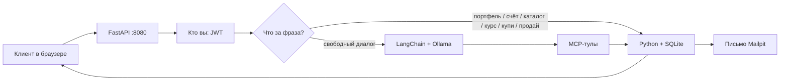
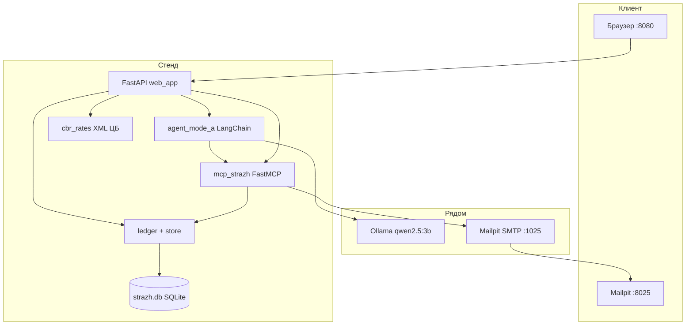
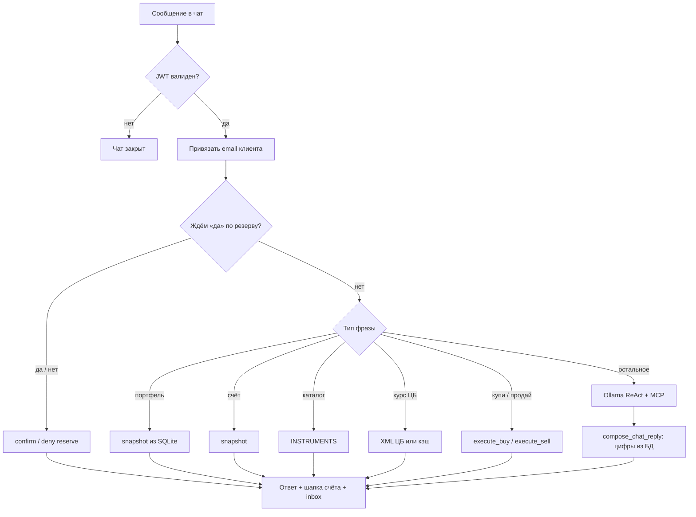
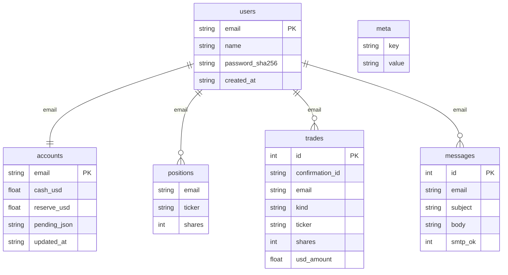

# Учебный стенд «Страж» — документация для защиты

**Режим A:** ИИ-агент без слоёв защиты. Живых денег нет. Клиент регистрируется, пишет в чат, система покупает и продаёт учебные акции, берёт курс ЦБ и шлёт письмо.

Эта папка — рабочий прототип для курса / гранта MLSecOps. Слои L1–L3 «Стража» здесь **намеренно не включены**: паническая продажа и номер счёта проходят. Сначала показываем, что агент умеет нажимать кнопки. Защита — следующий этап.

---

## 1. Текст для защиты (≈ 1–1,5 минуты)

> Мы собрали локальный учебный ИИ-управляющий сделками. Клиент регистрируется в браузере, получает свой счёт и пишет обычным языком: «купи 2 NVIDIA», «продай Apple», «какой курс ЦБ», «что у меня в портфеле».
>
> Стек: **LangChain** `create_agent` — это граф **LangGraph** ReAct. Модель — **Ollama**, `qwen2.5:3b`, только CPU. Кнопки агента — не произвольный Python, а **MCP-тулы**: свой сервер сделок и внешний сервис курсов ЦБ. Письма уходят на почту из регистрации через **Mailpit**. Учёт — **SQLite**, у каждого пользователя свой счёт, портфель и почта.
>
> Цифры счёта и сделки пишет код, не модель. Маленькая локальная LLM может ошибиться в числах, поэтому покупка, продажа, портфель и курс ЦБ перехватываются в Python и читаются из базы. Модель остаётся для свободного диалога.
>
> Это режим A: агент ещё не защищён. Так преподавателю видно поверхность атак. Дальше на тот же стенд навешиваются слои контроля.

**Демо за 40 секунд**

1. http://127.0.0.1:8080 — регистрация своей почты.  
2. «список акций» → NVDA / AAPL / MSFT.  
3. «купи 1 Apple» → остаток и портфель из базы, письмо в Mailpit.  
4. «продай 1 Apple» → деньги на основной счёт.  
5. Новый пользователь — чужой портфель не видит.

---

## 2. Что это за система (простыми словами)

Клиент думает, что говорит с чат-ботом. На деле чат — только вход. Дальше работает конвейер:

1. Кто вы? — регистрация / вход, JWT.  
2. Что вы хотите? — Python понимает «купи / продай / курс / портфель» без модели.  
3. Что сделать? — MCP-тул меняет счёт в SQLite.  
4. Что ответить? — текст собирается из снимка счёта.  
5. Кому письмо? — на email из сессии, не из текста чата.

Агент **сам учебный брокер**. На внешнюю биржу ничего не уходит.



---

## 3. Архитектура

### 3.1. Процессы на машине

При запуске `start_mode_a.ps1` поднимаются три сервиса:

| Процесс | Порт | Зачем |
|---|---|---|
| **uvicorn** `web_app.py` | 8080 | Сайт, API, чат |
| **Ollama** | 11434 | Локальная модель `qwen2.5:3b` |
| **Mailpit** | UI 8025, SMTP 1025 | Учебный почтовый ящик |

Дополнительно по запросу:

- MCP `mcp_strazh.py` — дочерний процесс по stdio (сделки, счёт, письмо).  
- MCP ЦБ `atomno-mcp-cbr-rates` через `uvx` — внешний каталог тулов. Курсы в вебе берём напрямую с XML ЦБ.



### 3.2. Стек технологий (что сказать преподавателю)

| Слой | Технология | Роль в стенде |
|---|---|---|
| Агент | LangChain `create_agent` | ReAct: мысль → тул → наблюдение → ответ |
| Граф | LangGraph | `create_agent` уже граф; точка `make_graph` для Agent Chat UI |
| Модель | Ollama + `ChatOllama` | Локально, без облака OpenAI |
| Тулы | MCP + FastMCP | Кнопки агента: купить, продать, счёт, письмо |
| Внешний МСП | ЦБ РФ `XML_daily.asp` | Официальные курсы валют |
| Веб | FastAPI + uvicorn | Регистрация, JWT, чат |
| Почта | SMTP → Mailpit | Письмо о сделке |
| Данные | SQLite WAL | Пользователи, счета, сделки, письма |
| Железо | CPU, `OLLAMA_NUM_GPU=0` | RTX 3050 4 ГБ не тянет GPU-инференс |

Почему маленькая модель и CPU: учебный ноутбук, 16 ГБ RAM. Модель нужна для языка. Правда по деньгам — в коде и базе.

### 3.3. Как обрабатывается одно сообщение



Идея для защиты: **модель не является источником истины**. Источник истины — SQLite.

---

## 4. Возможности агента

Агент умеет **нажать кнопки** после входа. Не умеет ходить на настоящую биржу.

### 4.1. Что видит клиент

| Клиент пишет | Что происходит | Откуда цифры |
|---|---|---|
| (не вошёл) | Чата нет | — |
| «список акций» / «какие можно купить» | Каталог NVDA, AAPL, MSFT | `ledger.INSTRUMENTS` |
| «состояние счёта» / «сколько денег» | Основной + резерв + бумаги | SQLite `accounts` |
| «портфель» / «какие акции у меня» | Только бумаги с `shares > 0` | SQLite `positions` |
| «курс ЦБ» / «доллар» / «все валюты» | Официальный XML ЦБ | `cbr.ru` + `cbr_cache.json` |
| «купи 2 NVIDIA» | Покупка с основного счёта | `execute_buy` |
| не хватает на основном, хватает с резервом | Вопрос «снять с резерва? да/нет» | `pending_reserve` |
| клиент: «да» | Покупка с резерва | `confirm_reserve_purchase` |
| клиент: «нет» | Покупка отменена, резерв цел | `deny_reserve_purchase` |
| не хватает даже с резервом | Сколько пополнить, сделка не пишется | код, без отрицательного баланса |
| «продай 1 Apple» | Продажа, выручка на основной счёт | `execute_sell` |
| успешная сделка | Письмо на email регистрации | SQLite `messages` + Mailpit |

Стартовый учебный счёт **нового** пользователя: **2000 $** основной, **5000 $** резерв, портфель пустой.

Учебные цены (не биржа):

| Тикер | Название | Цена |
|---|---|---|
| NVDA | NVIDIA | 915,75 $ |
| AAPL | Apple | 189,50 $ |
| MSFT | Microsoft | 415,00 $ |

### 4.2. MCP-тулы (кнопки)

Свой сервер `strazh-mcp` (`mcp_strazh.py`):

| Тул | Делает |
|---|---|
| `list_instruments` | Каталог бумаг |
| `list_currencies` | Список валют из XML ЦБ |
| `get_account` | Счёт вошедшего клиента |
| `get_portfolio` | Купленные бумаги |
| `execute_buy` | Покупка; при нехватке — `NEED_RESERVE_CONFIRM`, резерв сам не трогает |
| `execute_sell` | Продажа своих акций, деньги на `cash_usd` |
| `request_reserve_funds` | Перевод с резерва (в режиме A тул есть; в чате резерв идёт через «да») |
| `send_trade_email` | Письмо на почту из сессии |

После успешного buy/sell письмо уходит **само из кода**, модель не обязана вызывать `send_trade_email`.

Правила денег в коде:

- отрицательного баланса нет;  
- резерв только после явного «да»;  
- продать больше, чем есть в портфеле, нельзя;  
- адрес письма — JWT / сессия, не фраза в чате;  
- клиенты изолированы по `email`.

### 4.3. Чего агент не делает

- не отправляет на живого брокера;  
- не открывает сайты руками;  
- не запускает произвольные программы;  
- не берёт email из текста чата;  
- в режиме A **не** фильтрует панику и номер счёта (это учебная уязвимость).

---

## 5. Как сохраняются данные

Один файл базы: `stand/data/strazh.db` (режим WAL — веб и MCP могут писать одновременно).



### 5.1. Что в каких таблицах

| Таблица | Смысл |
|---|---|
| `users` | Регистрация: имя, почта, SHA-256 пароля |
| `accounts` | Основной и резервный доллары, отложенный вопрос про резерв |
| `positions` | Сколько акций какого тикера у этого email |
| `trades` | Журнал: BUY, SELL, RESERVE_ASK, RESERVE, RESERVE_DENY |
| `messages` | Копии писем «Куплено / Продано» |
| `meta` | Секрет JWT, флаг миграции со старых JSON |

### 5.2. Что где живёт (и что нет)

| Живёт | Где | После перезапуска |
|---|---|---|
| Учётки, счета, портфель | `strazh.db` | Сохраняется |
| История сделок | таблица `trades` | Сохраняется |
| Письма клиента | таблица `messages` + Mailpit | В БД сохраняется; Mailpit — пока процесс жив |
| JWT | cookie / заголовок, 8 часов | Нужен новый вход, если истёк |
| Текст чата на экране | память процесса + DOM | **Не** общий архик: при входе чат чистый. Счёт при этом свой |
| Курсы ЦБ | память 10 мин + `cbr_cache.json` | Кэш на диск, если сайт ЦБ недоступен |

Изоляция «как в банке»:

- ключ всех записей — `email`;  
- новый пользователь получает пустой портфель 2000 / 5000;  
- в чате на странице после входа история чужого диалога не показывается;  
- inbox на странице — только письма этого email;  
- Mailpit — общий учебный ящик преподавателя (все письма стенда), фильтр по полю To.

Старые `users.json`, `ledgers.json`, `emails/*.txt` больше не источник истины. При первом запуске JSON один раз мигрирует в SQLite.

### 5.3. Цепочка одной покупки в базе

1. `execute_buy` читает `accounts` + `positions` этого email.  
2. Если основной не хватает, а резерва хватает — в `accounts.pending_json` пишется вопрос, в `trades` — `RESERVE_ASK`. Денег ещё нет.  
3. «да» → с резерва на основной переносится нехватка, с основного списывается цена, `positions.shares += N`, `pending_json` очищается, в `trades` — BUY (и RESERVE, если трогали резерв).  
4. `messages` + SMTP Mailpit.  
5. Ответ в чат строится из `snapshot(email)`, не из текста модели.

Продажа: `positions.shares -= N`, `cash_usd += сумма`, письмо SELL.

---

## 6. Карта файлов

Код в `src/`, страницы в `static/`, базы и логи в `data/`, этот текст в `docs/`.

Только то, что нужно показывать. Служебное `.git` и кэш Python в защите не разбираем.

### 6.1. Запуск и вход

| Файл | Смысл |
|---|---|
| `start_mode_a.ps1` | Один скрипт: CPU-Ollama, Mailpit, uvicorn `:8080` |
| `requirements.txt` | LangChain, LangGraph, MCP, FastAPI |
| `README.md` | Как запустить стенд |
| `docs/ДОКУМЕНТАЦИЯ.md` | Этот файл — для преподавателя |
| `langgraph.json` | Точка графа `agent` → `make_graph` (на будущее Agent Chat UI) |

### 6.2. Веб и агент

| Файл | Смысл |
|---|---|
| `src/web_app.py` | Сервис: регистрация, JWT, чат, перехват команд |
| `static/index.html` | Одна страница: вход / регистрация / чат / шапка счёта / почта |
| `src/mail_app.py` | Отдельный почтовый сервис, только свой ящик |
| `static/mail.html` | Страница почты |
| `src/agent_mode_a.py` | Сборка LangChain-агента, системный промпт, MCP-клиент, Ollama |
| `src/chat_cli.py` | Тот же сценарий в терминале |
| `src/replies.py` | Разбор «купи/продай», тексты ответа **из счёта** |
| `src/selfcheck.py` | Приёмка без чата: тулы + JWT |

### 6.3. Кнопки, деньги, люди

| Файл | Смысл |
|---|---|
| `src/mcp_strazh.py` | FastMCP: сделки, счёт, портфель, письмо в почтовый сервис |
| `src/ledger.py` | Учебный кошелёк и каталог бумаг |
| `src/store.py` | SQLite-схема, WAL, миграция JSON |
| `src/mail_store.py` | База ящиков и писем |
| `src/mail_client.py` | Клиент Стража к почтовому сервису |
| `src/auth.py` | Регистрация, SHA-256, JWT HS256 на 8 часов |
| `src/cbr_rates.py` | Загрузка и разбор XML ЦБ |
| `data/cbr_cache.json` | Снимок курсов, если сайт ЦБ не ответил |

### 6.4. Данные и логи (не исходники)

| Файл | Смысл |
|---|---|
| `data/strazh.db` | Главное хранилище |
| `data/mail.db` | Ящики и письма |
| `data/trades.log` | Доп. JSON-строки по операциям MCP |
| `data/session.json` | Сессия терминального чата |
| `data/users.json` / `data/ledgers.json` | Наследие, только для одноразовой миграции |

`.gitignore` не коммитит базу, сессии, логи, `mailpit.exe`.

---

## 7. Содержание ключевых файлов (что внутри)

### `web_app.py` — дверь системы

- `POST /api/register`, `/api/login` — любой человек заводит учётку, сразу свой счёт.  
- Cookie `strazh_token` (JWT). Без него чат 401.  
- `POST /api/chat` — сердце: да/нет по резерву → портфель/счёт/каталог/курс/сделка → иначе LLM.  
- `GET /api/inbox` — письма только этого пользователя.  
- `_fresh_chat(email)` при входе: чужой диалог в памяти процесса не показывается.

### `agent_mode_a.py` — мозг на LangChain

- `MultiServerMCPClient`: процесс `mcp_strazh.py` + процесс ЦБ.  
- `ChatOllama(qwen2.5:3b, temperature=0, num_ctx=2048)`.  
- `create_agent(llm, tools, system_prompt=...)`.  
- Промпт запрещает отправлять к брокеру и выдумывать цифры; разрешает панику (режим A).  
- `make_graph()` — для `langgraph.json`.

### `mcp_strazh.py` — руки агента

- `set_client(email, name)` — кто клиент этого запроса (thread-local).  
- Покупка/продажа меняют SQLite, пишут `confirmation_id`.  
- Письмо: `From: strazh@local`, `To:` email сессии.

### `ledger.py` + `store.py` — бухгалтерия

- Каталог и правила счёта — `ledger`.  
- Таблицы и миграция — `store`.  
- `snapshot(email)` — то, что рисуется в шапке сайта и в ответах.

### `auth.py` — кто вошёл

- Пароль хранится как SHA-256.  
- JWT: `email`, `name`, срок 8 часов, подпись HS256.  
- Письма всегда на `email` из токена.

### `replies.py` — перевод с человеческого на кнопки

- «купи 4 nvidia» → `{side: BUY, ticker: NVDA, shares: 4}`.  
- Вызов тех же `execute_buy` / `execute_sell`.  
- Если модель болтала, а тул не вызвался — «сделка не записана», портфель из БД.

### `cbr_rates.py` — внешний мир

- Официальный `XML_daily.asp` (сначала HTTP, таймаут).  
- Все валюты дня ЦБ (~50 кодов), не три константы.  
- Если сеть упала — `cbr_cache.json`.

### `static/index.html` — лицо стенда

- Вкладки вход / регистрация.  
- После входа: кто вы, основной/резерв, чат, блок «ваша почта», ссылка на Mailpit.  
- При показе чата и выходе лента сообщений очищается.

---

## 8. Зачем перехват в Python, если есть агент

Для защиты это важно сказать честно.

`qwen2.5:3b` на CPU хорошо держит язык и может вызвать тул. Он плохо держит арифметику портфеля: может сказать «у вас 6 NVDA», хотя в базе 2. Для учебного брокера это недопустимо.

Поэтому:

- **кнопки и деньги** — Python + SQLite;  
- **модель** — свободный текст, когда фраза не про счёт / курс / сделку;  
- даже если модель вызвала тул, ответ клиенту пересобирается из `snapshot`.

Это не «агента нет». Это разделение: LLM планирует и говорит, учёт не врёт.

---

## 9. Как запустить перед показом

```powershell
cd "C:\Users\1\Desktop\neurohelp\MLSecOps Сириус"
.\stand\start_mode_a.ps1
```

Нужно заранее: Ollama, модель `qwen2.5:3b`, Python 3.12 в `.venv`, `uv` (для MCP ЦБ). Почта — сервис на :8090, его поднимает скрипт.

| Адрес | Что открыть преподавателю |
|---|---|
| http://127.0.0.1:8080 | Чат и регистрация |
| http://127.0.0.1:8090 | Почтовый сервис, только свой ящик |
| `stand/data/strazh.db` | Факт учёта |

Демо-учётки: `client@demo` / `demo`, `katya@demo` / `katya`. Лучше зарегистрировать новую почту на глазах.

Проверка без чата:

```powershell
.\.venv\Scripts\python.exe stand\src\selfcheck.py
```

---

## 10. Что уже есть и что намеренно позже

**Сейчас (режим A):** агент, MCP, Ollama, регистрация, JWT, SQLite, курс ЦБ, Mailpit, изоляция клиентов, перехват цифр в коде.

**Не в этом стенде (следующий этап курса):** слои защиты L1–L3, полноценный Agent Chat UI на `langgraph dev`, Docker на любую ОС, переписывание заявки.

Короткий тезис на слайд:

> «Страж», режим A — локальный LangChain-агент с MCP-кнопками, счётом в SQLite и почтой. Модель говорит, код считает, клиенты не видят чужие деньги. Защиты ещё нет — это и есть учебная поверхность атак.
