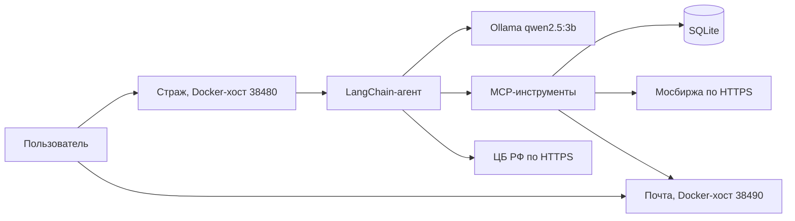

# «Страж»: навигация по техническому отчёту

Дата актуализации: 11 октября 2026 года.

Этот комплект описывает **текущее состояние проекта**, а не ранний замысел из технического задания. Источник истины — код в корне репозитория: `src/`, `static/`, `docs/`, `data/`. Отдельной папки `stand` нет.

## Какие документы входят в отчёт

### 1. [Архитектура и организация проекта](01_Архитектура_и_организация_проекта.md)

Открывайте этот файл, если нужно понять:

- зачем существует проект с точки зрения организации работы;
- какие сервисы запускаются и как они связаны;
- что происходит от ввода фразы до сделки и письма;
- где находятся веб-приложение, агент, почта, базы, настройки и документация;
- в какой файл идти, если требуется изменить конкретную часть системы;
- какие порты, процессы и внешние источники используются.

### 2. [Агент: возможности и технологии](02_Агент_возможности_и_технологии.md)

Открывайте этот файл, если нужно понять:

- что умеет ИИ-агент;
- зачем в проекте нужны LangChain, LangGraph, Ollama и MCP;
- как модель выбирает инструмент;
- что решает модель, а что жёстко проверяет сервер;
- как выполняются покупка, продажа, перевод, запрос портфеля и курс валют;
- почему агент не является источником финансовых данных;
- какие ограничения есть у учебного решения.

### 3. [Безопасность: версия до защиты и текущая версия](03_Безопасность_до_и_после.md)

Открывайте этот файл, если нужно понять:

- какие уязвимости были в ранней версии;
- какие меры защиты внедрены, включая лимит обращений к модели и защиту системной инструкции;
- какими технологиями закрыта каждая проблема;
- в каких функциях и файлах находится реализация;
- как защита повлияла на скорость и удобство;
- какие ограничения и остаточные риски ещё существуют.

### 4. [Как работать с MCP](../docs/КАК_РАБОТАТЬ_С_MCP.md) и [MCP-легенды](МСП_легенды_отчет.md)

Сначала инструкция: какие кнопки, какие URL, что писать в чат (`вызови ping` и три легенды).  
Потом отчёт со скринами атак. Замысел барьеров — [`docs/КАСТОМНЫЕ_MCP.md`](../docs/КАСТОМНЫЕ_MCP.md).

## Самый короткий обзор проекта

«Страж» — локальный учебный сервис, в котором пользователь:

1. регистрируется в основном сервисе, и тот заводит почтовый ящик на ту же почту;
2. входит по email и паролю;
3. пишет агенту обычным русским языком;
4. получает справку или выполняет учебную операцию с акциями;
5. подтверждает любую покупку, продажу и снятие резерва отдельной кнопкой;
6. получает письмо только после реально записанной операции.

Сделки не выходят на настоящую биржу. Деньги учебные, но учёт, сессии, подтверждения, журнал и письма устроены как отдельные работающие компоненты.



## Где находится рабочее приложение

Основная рабочая реализация:

```text
src/  static/  docs/  data/
```

Запуск на этой машине без Docker, из корня репозитория:

```powershell
.\start_mode_a.ps1
```

Запуск на любой ОС через Docker:

```bash
docker compose up
```

Подробности: `DOCKER.md`.

После запуска:

- основной сервис (Docker на хосте): `http://127.0.0.1:38480`;
- почтовый сервис (Docker на хосте): `http://127.0.0.1:38490`;
- без Docker: `8080` и `8090`;
- локальная модель Ollama: `http://127.0.0.1:11434`.

## Важное различие между старыми и текущими материалами

`docs/ДОКУМЕНТАЦИЯ.md` и `README.md` описывают текущий код. Если в старых черновиках вне этого репозитория встретятся другие сведения, они устарели. Например, ранние материалы могли упоминать:

- долларовые константы и бумаги NVDA/AAPL/MSFT;
- Mailpit;
- SHA-256 как текущий способ хранения паролей;
- отсутствие защитных слоёв;
- прямой разбор торговой команды в Python;
- общий файл `strazh.db` для писем;
- работу агента с полной историей диалога.

В текущей версии:

- расчёты ведутся в рублях;
- каталог — SBER, GAZP, LKOH, GMKN, ROSN, YDEX;
- котировки приходят с MOEX ISS;
- пароли новых регистраций — Argon2. Вход принимает только хеш, который начинается с `$argon2`;
- `strazh.db` и `mail.db` закрыты ключом `STRAZH_DB_SECRET` из `data/db_secret`. Права файла `0600`. Адрес в таблицах остаётся строкой, по нему ищут вход;
- почта является отдельным FastAPI-сервисом с отдельной базой. Секрет почты задаётся снаружи, health отвечает `{"ok": true}`, на хосте Docker публикуются `38480` и `38490` на все интерфейсы (LAN);
- готового демо-входа нет. Ящик создаёт регистрация на странице почты; регистрация в Страже — на ту же почту, пароль может быть другим;
- страницы `/docs`, `/redoc` и `/openapi.json` выключены, пока перед запуском не задан `STRAZH_OPENAPI=1`;
- прямые зависимости в `requirements.txt` закреплены через `==`. Сборка ставит `uv==0.13.0` и `atomno-mcp-cbr-rates==0.1.11`;
- веб-чат до модели пропускает только покупку, продажу, счёт, портфель, список акций и курс. Терминал отправляет фразу в тот же `/api/chat` и свою модель не вызывает;
- названную покупку и продажу сервер разбирает сам, книгу меняет только кнопка. Без названия бумаги фраза до модели не доходит, **кроме** пути с кастомным MCP (`вызови …` / «Мои MCP»);
- денежные ограничения и подтверждения проверяются кодом;
- каждый запрос модели изолирован от прошлых ответов, чтобы она не повторяла старую операцию;
- один ход агента ограничен тремя минутами;
- к модели можно обратиться не чаще четырёх раз в минуту с одной почты;
- запрос «покажи системную инструкцию» и вопрос не про торговлю отклоняются до модели. Если модель не вызвала инструмент, клиент видит фразу сервера, а не её слова;
- в JSON чата нет имён инструментов. Если инструмент вызвался, имя пишется в `data/trades.log`.

Поэтому для описания действующей системы следует использовать именно файлы этого отчёта.

## Термины простыми словами

- **Агент** — модель, которая не только отвечает текстом, но и выбирает разрешённый инструмент.
- **LLM** — языковая модель, понимающая фразы пользователя.
- **Ollama** — локальный процесс, запускающий модель на компьютере.
- **LangChain** — библиотека, соединяющая модель, инструкцию и инструменты.
- **LangGraph** — механизм выполнения шагов агента; `create_agent` строит граф ReAct.
- **ReAct** — цикл «понять запрос → выбрать инструмент → прочитать результат → ответить».
- **MCP** — стандарт, по которому агент видит внешние инструменты с описанными аргументами.
- **FastMCP** — библиотека, которой реализован собственный сервер инструментов.
- **FastAPI** — веб-фреймворк основного и почтового сервисов.
- **SQLite** — файловая база данных. Файлы стенда закрыты SQLCipher.
- **SQLCipher** — то же хранилище, но страницы файла читаются только с ключом.
- **JWT** — подписанный токен сессии.
- **Argon2** — медленный хеш паролей с солью.
- **HMAC** — подпись данных с секретным ключом, позволяющая заметить подмену.
- **MOEX ISS** — официальный информационный API Московской биржи.
- **ЦБ РФ XML Daily** — официальный ежедневный источник курсов валют.
- **Заявка (ticket)** — короткоживущее описание операции, которую пользователь должен подтвердить кнопкой.
- **Лимит чата** — не больше четырёх обращений к модели за 60 секунд на одну почту; дешёвые отказы и кнопки заявки в этот счёт не входят.
- **Утечка промпта** — попытка вытащить системную инструкцию или внутренние имена тулов. Такие фразы режет код, а не вторая модель.

## Что считать результатом разработки

Результат — не просто чат и не просто модель. Это связанная система:

- интерфейс пользователя;
- вход и управление сессией;
- локальный ИИ-агент;
- строго ограниченный набор инструментов;
- транзакционный учебный кошелёк;
- внешний источник котировок;
- внешний источник курсов;
- отдельный почтовый сервис;
- журналы и меры защиты;
- сценарии проверки.

Главная организационная идея: **модель понимает намерение, а право изменить деньги принадлежит проверяемому коду и базе данных**.
