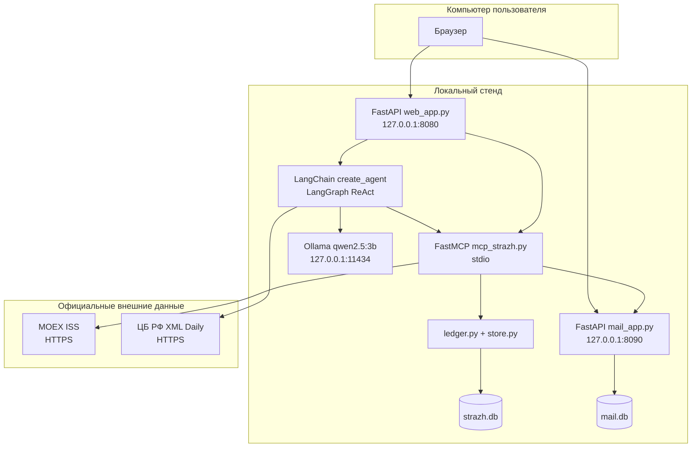
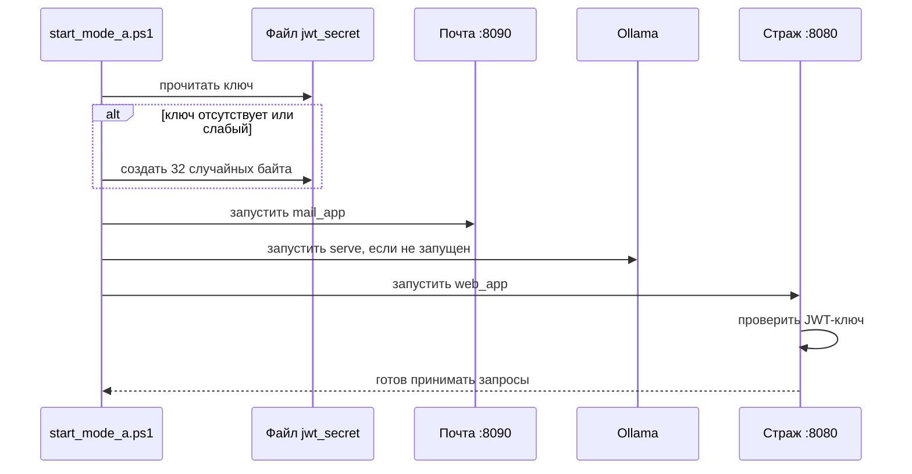
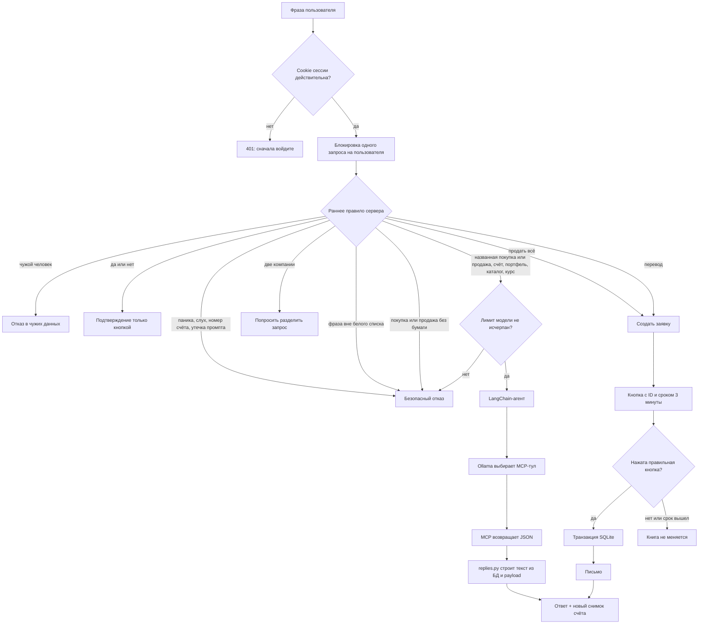
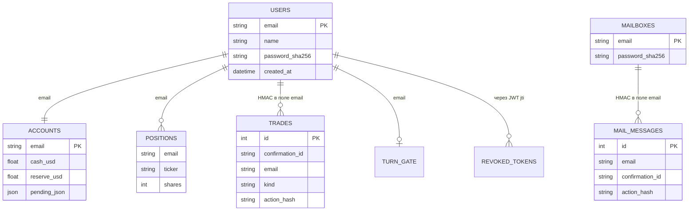

# Архитектура и организация проекта «Страж»

## 1. Назначение разработки

«Страж» — учебный стенд MLSecOps для исследования автономного ИИ-агента, который способен не только написать ответ, но и выполнить действие.

Обычный чат-бот может ошибиться в тексте. Агент с инструментами может:

- изменить учебный денежный остаток;
- купить или продать акции;
- перевести деньги между основным и резервным счетами;
- обратиться к внешнему источнику данных;
- создать письмо о выполненной операции.

Поэтому цель проекта — показать, как организовать работу такого агента так, чтобы:

1. языковая модель понимала свободную фразу человека;
2. модель имела только ограниченный набор инструментов;
3. финансовые правила проверял обычный код;
4. состояние хранилось в транзакционной базе;
5. чувствительные действия требовали отдельного подтверждения;
6. внешние данные поступали по защищённому каналу;
7. пользователь видел только данные своей сессии;
8. письмо появлялось только после реальной записи операции.

Система не подключена к настоящему брокеру. Все деньги и акции учебные.

## 2. Организационный смысл проекта

Проект разделяет ответственность между участниками системы.

### Пользователь

Формулирует намерение обычным языком:

- «покажи мой портфель»;
- «купи 2 акции Норникеля»;
- «продай акцию Сбера»;
- «покажи курс доллара»;
- «переведи все деньги с резервного на основной».

Пользователь не вводит команды базы данных и не вызывает функции напрямую.

### Языковая модель

Определяет, какой из разрешённых инструментов соответствует текущей фразе. Модель не должна сама рассчитывать цену, остаток или количество акций.

### Веб-сервис

Проверяет сессию, блокирует явно опасные или неоднозначные случаи, управляет кнопками подтверждения, ограничивает один запрос по времени и собирает окончательный ответ.

### MCP-сервис сделок

Выполняет операции по правилам: проверяет остатки, создаёт заявку, записывает сделку, вызывает почтовый сервис.

### SQLite

Является источником истины по пользователям, остаткам, портфелю, заявкам и журналу.

### Почтовый сервис

Хранит отдельные ящики и показывает каждому владельцу только его письма.

### Внешние источники

Московская биржа предоставляет цены акций, Центральный банк — курсы валют.

Такое разделение позволяет менять модель или интерфейс, не переписывая бухгалтерию и правила безопасности.

## 3. Общая схема системы



## 4. Какие процессы запускаются

Скрипт `start_mode_a.ps1` подготавливает окружение и запускает систему.

### Основной веб-сервис

- Процесс: `uvicorn web_app:app`.
- Адрес: `127.0.0.1:8080`.
- Назначение: регистрация, вход, чат, счёт, подтверждение заявок, выход.

### Почтовый сервис

- Процесс: `uvicorn mail_app:app`.
- Адрес: `127.0.0.1:8090`.
- Назначение: создание ящика, вход, список и чтение собственных писем, внутренняя доставка.
- Запускается скрытым дочерним процессом.

### Ollama

- Адрес по умолчанию: `127.0.0.1:11434`.
- Модель: `qwen2.5:3b`.
- Режим: CPU, `OLLAMA_NUM_GPU=0`, библиотека `cpu_avx2`.
- Назначение: понять фразу и выбрать инструмент.

### MCP-сервис «Страж»

- Транспорт: стандартный ввод/вывод (`stdio`), отдельный HTTP-порт не нужен.
- Запускается адаптером LangChain.
- Назначение: каталог, счёт, портфель, покупка, продажа и служебные операции.

### MCP курсов валют

- Команда: `atomno-mcp-cbr-rates` через `uvx`/`uv`.
- Назначение: предоставить модели инструменты `get_rate` или `get_currency_rate`.
- Для окончательного вывода официального числа также используется локальный модуль `cbr_rates.py`.

## 5. Последовательность запуска



Сервис по умолчанию слушает только localhost. Если задать внешний адрес через `STRAZH_BIND`, скрипт требует сертификат и ключ TLS.

## 6. Жизненный цикл запроса



### Почему каждый ход модели изолирован

В модель передаётся только текущая фраза. Предыдущие ответы не добавляются. Это сделано после обнаружения, что маленькая модель могла повторить прошлый курс или прошлую сделку вместо нового действия.

Следствие:

- запросы не смешиваются;
- старый чек не становится новым ответом;
- фраза «купи ещё одну» без названия бумаги до модели не доходит: сервер просит назвать бумагу из каталога.

### Лимит обращений к модели

Счётчик считает только те запросы, которые реально уходят в Ollama: не больше четырёх за 60 секунд на одну почту. Отказы до модели (чужой счёт, две компании, паника, утечка инструкции, фраза вне белого списка, покупка или продажа без названия бумаги) и нажатие кнопки заявки в лимит не входят. Пятый вызов модели за минуту получает «Слишком много запросов к модели. Подождите минуту.»

## 7. Веб-API основного сервиса

### Открытые маршруты

- `GET /` — страница `static/index.html`.
- `POST /api/register` — регистрация на уже существующий почтовый ящик.
- `POST /api/login` — вход только по email.
- `GET /api/health` — только `{"ok": true}`.

### Маршруты с сессией

- `GET /api/me` — имя, email и снимок собственного счёта.
- `GET /api/account` — собственный счёт и портфель.
- `POST /api/chat` — один запрос агенту; если фраза дошла до модели, она входит в лимит 4 обращения / 60 секунд на почту.
- `POST /api/logout` — отзыв текущего JWT.
- `POST /api/reserve/confirm` — подтверждение заявки по ID.
- `POST /api/reserve/deny` — отмена заявки по ID.

### Закрытый прежний путь

`POST /api/transfer` не выполняет перевод. Перевод разрешён только через заявку и кнопку.

## 8. API почтового сервиса

### Маршруты пользователя

- `GET /` — страница `static/mail.html`.
- `POST /api/mailbox` — создать ящик.
- `POST /api/login` — войти в ящик.
- `POST /api/logout` — выйти.
- `GET /api/me` — узнать текущий ящик.
- `GET /api/inbox` — список собственных писем.
- `GET /api/inbox/{id}` — одно собственное письмо.

### Внутренние маршруты

- `GET /api/internal/exists` — проверить существование ящика.
- `POST /api/internal/deliver` — доставить письмо.

Внутренние маршруты требуют заголовок `X-Mail-Token`. Для доставки обязателен `confirmation_id`.

## 9. Базы данных

### `data/strazh.db`

Главная база учёта. SQLite работает в режиме WAL, чтобы веб-процесс и MCP-процесс могли безопаснее обращаться к одному файлу.

Основные таблицы:

- `users` — email, отображаемое имя, хеш пароля, дата создания;
- `accounts` — основной остаток, резерв, JSON открытой заявки;
- `positions` — количество акций по тикеру;
- `trades` — журнал операций и номера подтверждений; поле `email` хранит HMAC автора, не открытый адрес;
- `messages` — схема совместимости со старой архитектурой, текущие письма в неё не пишутся;
- `meta` — служебные значения и флаги миграции;
- `revoked_tokens` — отозванные JWT;
- `turn_gate` — класс текущего запроса, фраза и оставшееся число денежных проводок;
- `mailboxes` — совместимый список ящиков, разрешённых для регистрации.

### `data/mail.db`

Отдельная база почтового сервиса:

- `mailboxes` — ящик и хеш пароля;
- `messages` — письмо, номер подтверждения, сторона сделки, тикер и HMAC.

### Связи данных



Поля `cash_usd`, `reserve_usd`, `usd_amount` сохранили старые названия для совместимости, но в текущем приложении означают **рубли**.

## 10. Структура всего репозитория

Этот репозиторий и есть стенд. Его корень описан в разделе 11: `src/`, `static/`, `docs/`, `data/`, Docker-файлы и `отчет по проделанной работе/`. Отдельной папки `stand` и соседних папок `заявка` здесь нет.

### `.git/`

История этого репозитория.

### `отчет по проделанной работе/`

Итоговая понятная документация по текущему проекту. Созданные файлы не заменяют исходные планы, а объясняют фактически работающую версию.

## 11. Структура корня репозитория

Код стенда лежит в корне этого репозитория, отдельной папки `stand` нет.

```text
./
├── .git/
├── .gitignore
├── README.md
├── DOCKER.md
├── Dockerfile
├── docker-compose.yml
├── entrypoint.py
├── requirements.txt
├── start_mode_a.ps1
├── langgraph.json
├── src/
├── static/
├── data/
└── docs/
```

### Корневые файлы

- `.git/` — история этого репозитория.
- `.gitignore` — исключает базы, секреты, логи, сессии, кэш Python и бинарные почтовые утилиты.
- `README.md` — инструкция запуска.
- `requirements.txt` — Python-зависимости: LangChain, Ollama, LangGraph, MCP, FastMCP, FastAPI, uvicorn, Argon2.
- `start_mode_a.ps1` — локальный запуск на Windows.
- `Dockerfile`, `docker-compose.yml`, `entrypoint.py` — запуск через Docker на любой ОС.
- `langgraph.json` — граф `agent`, ведущий к `agent_mode_a.py:make_graph`.

## 12. Карта `src`

### Агент и веб

- `agent_mode_a.py` — системная инструкция, сборка `ChatOllama`, `MultiServerMCPClient`, allowlist инструментов, извлечение результатов.
- `web_app.py` — FastAPI основного сервиса, сессии, API, ранние правила, лимит 4 обращения к модели в минуту, блокировка параллельных запросов, таймаут 180 секунд.
- `chat_cli.py` — терминальный клиент того же агента. Он не вызывает `story_block` и белый список намерений. Ответ без инструмента всё равно собирает `compose_chat_reply`.
- `replies.py` — безопасное формирование клиентских ответов из payload и снимка базы.

### Сделки и политика

- `mcp_strazh.py` — FastMCP-инструменты, заявки, покупки, продажи, перевод, продажа портфеля и письма.
- `ledger.py` — кошелёк, портфель, транзакционное обновление и журнал.
- `policy.py` — порог кнопки 0 ₽, поэтому любая покупка и продажа ждут кнопку, срок заявки 180 секунд, разбор тикера и числа из фразы, отказ на панику, длинный номер счёта и запрос системной инструкции.
- `store.py` — схема `strazh.db`, WAL, миграция старых JSON, отзыв токенов и `turn_gate`.

### Вход и целостность

- `auth.py` — регистрация, вход, JWT HS256, проверка пользователя и отзыва.
- `password_hash.py` — Argon2, политика пароля, совместимость со старым SHA-256.
- `action_hash.py` — HMAC автора и состава действия.

### Внешние данные

- `moex_quotes.py` — котировки MOEX ISS, TLS, кэш, коридор 20%, таймаут.
- `cbr_rates.py` — курсы ЦБ РФ по HTTPS, XML-парсер и дисковый кэш.

### Почта

- `mail_app.py` — FastAPI почтового сервиса.
- `mail_store.py` — `mail.db`, ящики, письма, HMAC.
- `mail_client.py` — HTTP-клиент Стража к почтовому сервису.

### Поддержка

- `paths.py` — вычисляет корень репозитория, `src`, `data` и `static`.
- `selfcheck.py` — исторический сценарий автоматической проверки; перед использованием его ожидания нужно сверять с текущими кнопками и `turn_gate`.

## 13. Папки интерфейса, данных и документации

### `static/`

- `index.html` — регистрация, вход, чат, баланс, кнопки заявки.
- `mail.html` — создание ящика, вход, список и чтение писем.

Обе страницы используют обычный JavaScript без отдельного frontend-фреймворка.

### `data/`

- `strazh.db` — главная база;
- `mail.db` — почтовая база;
- `jwt_secret` — секрет подписи JWT основного сервиса;
- `moex_cache.json` — последний кэш MOEX;
- `cbr_cache.json` — кэш курсов ЦБ;
- `trades.log` — вспомогательный JSON-журнал.

Эта папка содержит чувствительные и изменяемые данные. Её содержимое нельзя публиковать и коммитить.

### `docs/`

`ДОКУМЕНТАЦИЯ.md` описывает текущий стенд: каталог Мосбиржи, почта на порту 8090, белый список намерений, кнопка на любую покупку и продажу. `НАЙДЕННЫЕ_УЯЗВИМОСТИ.md` — протокол проверок. `ИСПРАВЛЕНИЕ_УЯЗВИМОСТЕЙ.md` — уже внесённые правки. В веб-чате закрыты пункты 1, 2, 3 и 4. Пункт 4 закрыт белым списком и фразой сервера без инструмента.

## 14. Куда идти для типовых изменений

- Изменить инструкцию модели — `src/agent_mode_a.py`.
- Изменить разрешённые модели инструменты — allowlist в `agent_mode_a.py`.
- Добавить/изменить HTTP API — `src/web_app.py`.
- Изменить правила подтверждения — `policy.py`, `web_app.py`, `mcp_strazh.py`.
- Изменить отказ на запрос инструкции — `policy.story_block`. Если инструмент не вызвался, клиенту отвечает `replies.NO_TOOL_REPLY`, а не текст модели.
- Изменить лимит обращений к модели — `_CHAT_LIMIT` и `_CHAT_WINDOW` в `web_app.py`.
- Изменить покупку или продажу — `mcp_strazh.py` и `ledger.py`.
- Изменить тексты ответов — `replies.py`.
- Изменить сессию и вход — `auth.py`, `web_app.py`.
- Изменить политику паролей — `password_hash.py`.
- Изменить схему основной БД — `store.py`.
- Изменить почтовую БД — `mail_store.py`.
- Изменить доставку писем — `mail_client.py`, `mail_app.py`, `mcp_strazh.py`.
- Изменить источник котировок — `moex_quotes.py`.
- Изменить источник курсов — `cbr_rates.py`.
- Изменить страницу Стража — `static/index.html`.
- Изменить страницу почты — `static/mail.html`.
- Изменить запуск и сетевой режим — `start_mode_a.ps1`, `Dockerfile`, `docker-compose.yml` или `entrypoint.py` в корне.

## 15. Эксплуатация

### Предварительные условия без Docker

- Windows PowerShell;
- Python 3.12 и `.venv`;
- Ollama;
- модель `qwen2.5:3b`;
- `uv` или `uvx`.

### Запуск через Docker

На любой ОС достаточно Docker Desktop или Docker Engine:

```bash
docker compose up
```

Контейнер Стража поднимает почту и веб, контейнер Ollama даёт модель. Первый старт качает `qwen2.5:3b`. Локальный `start_mode_a.ps1` при этом не нужен. Инструкция публикации на Docker Hub — `DOCKER.md`.

### Остановка

Скрипт запуска держит основной uvicorn в текущем окне. Закрытие окна останавливает основной сервис. Скрытый почтовый процесс при повторном запуске нужно также остановить, чтобы порт 8090 не был занят.

### Что резервировать

Для сохранения учебного состояния достаточно:

- `data/strazh.db`;
- `data/mail.db`;
- нужных локальных секретов.

Базы нельзя отправлять в публичный репозиторий.

## 16. Текущие границы проекта

- Это локальный учебный стенд, а не брокерская система.
- Настоящих денежных операций нет.
- Нет промышленного управления секретами.
- Нет распределённой блокировки для нескольких серверов.
- SQLite подходит для стенда, но не заменяет промышленную СУБД при высокой нагрузке.
- Маленькая локальная модель иногда ошибается; поэтому денежные правила вынесены из модели.
- Качество внешних ответов зависит от доступности MOEX, ЦБ и локального Ollama.
- Частота живых вызовов модели ограничена четырьмя обращениями в минуту на одну почту.
