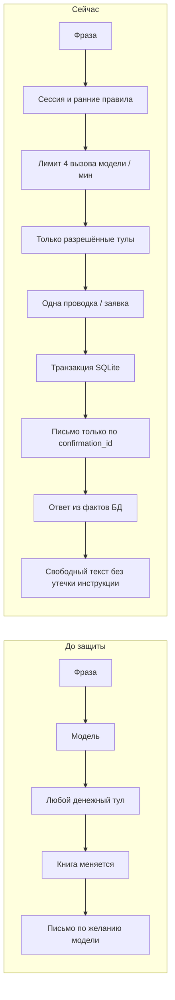
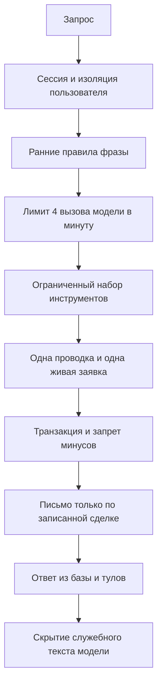
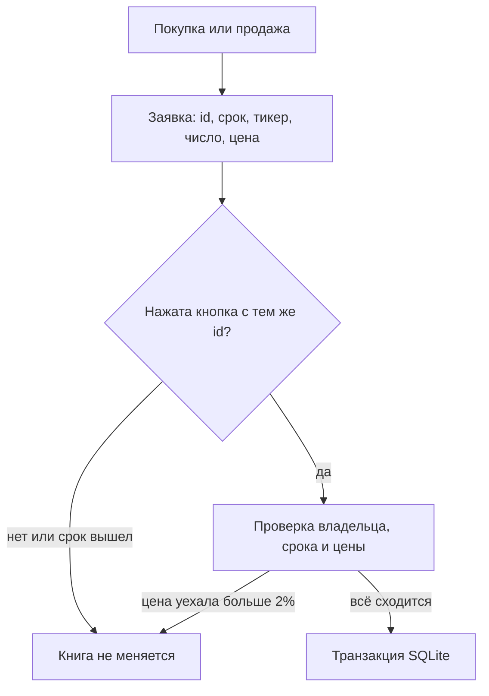

# Безопасность: версия до защиты и текущая защищённая версия

## 1. Как читать этот документ

Здесь сравниваются две стадии одного учебного стенда.

**Версия до внедрения защиты** — ранний режим A: модель почти напрямую управляла сделками, сессия и пароли были учебными, внешние данные принимались слишком доверчиво.

**Текущая версия** — тот же агент с инструментами, но вокруг него появились проверяемые слои: сессия, политика фразы, ограниченный набор тулов, заявки с кнопкой, транзакции, HTTPS-котировки, письмо только после записи сделки, лимит обращений к модели и защита системной инструкции.

Это не промышленный брокер. Защита показывает правильную организацию агентной системы, а не обещание устойчивости ко всем атакам.

Где какая проверка лежит сейчас (без сборки в один модуль): [`docs/ГАРДРЕЙЛЫ.md`](../docs/ГАРДРЕЙЛЫ.md).

## 2. Короткое сравнение

| Область | До защиты | Сейчас |
|---|---|---|
| Вход | слабый пароль, разные ошибки, токен в браузерном хранилище | Argon2, одна ошибка входа, HttpOnly cookie, отзыв JWT |
| Сеть | широкий bind без TLS | localhost; внешний bind только с сертификатом |
| Модель | почти все денежные тулы | белый список справочных и простых сделок |
| Подтверждение | слово «да» | кнопка, ID, срок 3 минуты, замороженная цена |
| Деньги | проверка и запись могли расходиться | одна транзакция, отрицательные остатки запрещены |
| Цена | HTTP и любая положительная цифра | HTTPS, коридор 20%, заявка не дорожает больше чем на 2% |
| Почта | письмо можно было отправить без сделки | письмо только если номер есть в журнале |
| Ответ | модель могла придумать цифры | текст и снимок счёта из базы; имена инструментов в JSON чата не входят |
| Частота модели | любой темп запросов к Ollama | не больше 4 живых вызовов за 60 секунд на почту |
| Системная инструкция | фраза «покажи промпт» шла в модель | отказ до модели; без инструмента клиент видит фразу сервера, не текст модели |

## 3. Почему защите подвергался именно агент

Обычное веб-приложение опасно, если сломана авторизация. Агент опасен ещё сильнее: он сам выбирает действие.

До защиты достаточно было убедить модель фразой. После этого она могла:

- снять резерв;
- продать чужие по смыслу бумаги;
- несколько раз провести одну и ту же операцию за один ход;
- отправить письмо «Куплено» без записи в книге;
- повторить старый ответ вместо нового запроса.

Поэтому защита строилась слоями. Если модель ошибётся, следующий слой не должен менять деньги.

## 4. Версия до внедрения защиты

Ниже — фактическое состояние раннего стенда, а не идеальный замысел из ТЗ.

### 4.1. Сессии и вход

- JWT подписывался постоянным учебным секретом.
- Из токена брались email и имя без обязательной проверки строки в таблице пользователей.
- Токен попадал в JSON ответа и мог храниться в `localStorage`.
- Выход удалял копию в браузере, но не отзывал сам токен.
- Был запасной путь через `session.json` и демо-клиента для MCP.
- Сервис мог слушать широкий сетевой интерфейс без TLS.
- Вход различал «нет такой учётки» и «неверный пароль».
- Пароль хранился как SHA-256 без соли, минимальная длина была 3 символа.
- В отдельных местах вход допускал имя, а не только email.

Следствие: украденный или подобранный токен и слабый пароль давали полный доступ к учебному счёту.

### 4.2. Денежные действия модели

Модель видела опасные инструменты:

- перевод между счетами;
- подтверждение резерва;
- продажу всего портфеля;
- прямую отправку письма.

Слово «да» в чате могло завершить операцию. Один ход ReAct мог вызвать несколько денежных тулов. Покупка иногда разбиралась Python-кодом по фразе, а не только агентом.

Следствие: достаточно было подобрать формулировку, и книга менялась без отдельного подтверждения человеком.

### 4.3. Цена и внешние данные

- MOEX и ЦБ вызывались по HTTP.
- Принималась любая положительная цена.
- При подтверждении резерва цена пересчитывалась заново.
- Подменённый кэш мог стать ценой сделки.

Следствие: перехват или порча внешнего ответа меняли сумму покупки и продажи.

### 4.4. Учёт

- Остаток акций можно было проверить до записи, а записать позже.
- Отрицательная позиция могла появиться и затем скрыться в снимке портфеля.
- Несколько параллельных запросов одного пользователя не запирались.

Следствие: теоретически возможны были двойная продажа и отрицательный остаток.

### 4.5. Почта и разведка

- Регистрация требовала только факт существования ящика.
- Письмо можно было отправить с произвольным текстом и номером.
- `/api/health` сообщал путь к базе, модель и число агентов.

Следствие: злоумышленник получал лишние сведения о внутреннем устройстве и мог создать ложное письмо.

### 4.6. Качество ответов агента

Это тоже было уязвимостью удобства и доверия:

- история чата попадала в модель;
- старый курс или старая сделка повторялись как новый ответ;
- модель отвечала «ok» или «ход закрыт»;
- клиент мог увидеть свой счёт после вопроса про чужой;
- не было лимита на частоту живых вызовов модели;
- фраза «покажи системную инструкцию» доходила до модели.

## 5. Как защита внедрялась

Защита добавлялась поэтапно в этом репозитории. Ниже — рабочие шаги и технологии, которыми закрывалась каждая группа угроз.

### Хронология по коммитам

1. `a7960ad` — Argon2 и политика пароля.
2. `ad6bd7a` — HMAC автора и состава действия в журнале.
3. `c1672f7` — сессия, cookie, отзыв токена, кнопки заявок, localhost.
4. `fc22a1d` — отдельная проверка фразы той же моделью («ДА/НЕТ»).
5. `1d1f7d3` — продажа в одной транзакции, запрет отрицательных остатков.
6. `a482f48` — HTTPS для MOEX и ЦБ, коридор цены, замороженная цена заявки.
7. `659fb3a` — одна живая заявка.
8. `c3fe80a` — письмо только при существующей записи сделки.
9. `72a36b4` — вход только по email, тихий health основного сервиса.
10. `d070d3b` — снят модельный фильтр «ДА/НЕТ», в агент уходит только текущая фраза.
11. `7e45e64` — точечный запрос котировки, отказ на две компании, честный курс одной валюты, таймаут хода 3 минуты.
12. `7146dec` — лимит 4 обращения к модели в минуту на почту; отказ на запрос инструкции до модели; скрытие служебных слов в свободном ответе.

## 6. Какие меры закрыли какие уязвимости

### 6.1. Подделка и кража сессии

**Уязвимость.** Постоянный секрет JWT, токен в JavaScript, отсутствие отзыва, доверие к полям токена.

**Как устранено.**

- Ключ подписи берётся только из `STRAZH_JWT_SECRET`.
- Скрипт запуска создаёт случайные 32 байта в `data/jwt_secret`, если ключа нет или он учебный.
- `signing_secret()` отказывается стартовать с коротким или демо-ключом.
- JWT содержит `sub`, `jti`, `iat`, `exp` и живёт 8 часов.
- Имя клиента читается из таблицы `users`, а не из токена.
- Если пользователя уже нет, сессия недействительна.
- Токен кладётся в cookie `strazh_token`: `HttpOnly`, `SameSite=Lax`.
- В JSON входа токена нет.
- Выход записывает `jti` в `revoked_tokens`.
- На вход: 8 неудач с одного IP за 60 секунд дают 429.
- Текст ошибки входа один: «Неверная почта или пароль».

**Где в коде:** `auth.py`, `store.py`, `web_app.py`, `start_mode_a.ps1`, `static/index.html`.

**Как повлияло на работу.** Пользователь входит как раньше, но сессия не видна скриптам страницы. После выхода старый токен больше не принимается. При серии неверных паролей вход временно блокируется.

**Остаток.** Cookie не ставит флаг `Secure`, потому что обычный режим — HTTP на localhost. Для внешнего показа нужен TLS, но код cookie сам флаг не включает.

### 6.2. Слабые пароли

**Уязвимость.** SHA-256 без соли и слишком короткий пароль.

**Как устранено.**

- Новые пароли хешируются Argon2.
- Политика: не короче 8 знаков, есть заглавная, строчная буква и символ.
- Вход принимает только хеш, который начинается с `$argon2`. SHA-256 без соли больше не открывает ни учётку, ни ящик.
- Демо-учётки `client@demo` и `katya@demo` больше не создаются. Уже записанные строки этих адресов удаляются при открытии базы.

**Где в коде:** `password_hash.py`, `auth.py`, `store._drop_demo_accounts`, `mail_store._drop_demo`.

**Как повлияло на работу.** Регистрация стала строже. Готового входа с коротким паролем больше нет. Новый ящик появляется при регистрации в Страже на ту же почту.

### 6.3. Подмена журнала и чтение автора сделки

**Уязвимость.** Email и состав операции лежали в журнале открытым текстом.

**Как устранено.**

- В `trades` и почтовых письмах автор пишется как HMAC-SHA256 от email.
- Отдельно считается digest состава действия.
- В `trades.log` адрес тоже заменяется хешем.

**Где в коде:** `action_hash.py`, `ledger.record_trade`, `mail_store.deliver`, `mcp_strazh._log`.

**Как повлияло на работу.** Клиент по-прежнему видит свой счёт и свои письма. При чтении файла базы чужой аналитик не видит открытый email в журнале сделок.

**Остаток.** HMAC — псевдоним автора в журнале, не ключ файла. Сам файл закрыт отдельно: см. пункт 6.14. Ключ HMAC журнала сделок берётся из `meta.jwt_secret` и в старых базах может остаться учебным. Почтовый HMAC берётся из `STRAZH_MAIL_SECRET`, константы в коде больше нет.

### 6.4. Модель сама двигала опасные деньги

**Уязвимость.** У модели были перевод, продажа всего портфеля, подтверждение резерва и отправка письма.

**Как устранено.**

Белый список в `build_agent()` оставляет только:

- `execute_buy`
- `execute_sell`
- `get_account`
- `get_portfolio`
- `list_instruments`
- `list_currencies`
- `get_rate` / `get_currency_rate`

Продажа всего портфеля и перевод создаются сервером:

- `policy.is_sell_all` → `propose_sell_all`;
- `policy.parse_transfer` → `propose_transfer`.

Подтверждение идёт только через кнопки:

- `POST /api/reserve/confirm`
- `POST /api/reserve/deny`

Прямой `POST /api/transfer` всегда отвергается.

**Как повлияло на работу.** Справку по-прежнему делает агент. Любая покупка и продажа двухшаговые: фраза создаёт заявку, кнопка её исполняет. Слово «да» деньги не двигает. Фраза без названия бумаги до модели не доходит.

**Остаток.** В файле MCP функции `confirm_reserve_purchase` и `transfer_between` ещё существуют. Веб-агент их не видит, но прямой вызов MCP в обход веб-слоя остаётся поверхностью для разработчика стенда.

### 6.5. Несколько сделок за одну фразу

**Уязвимость.** Один ход модели мог купить и продать несколько раз.

**Как устранено.**

Таблица `turn_gate` запоминает:

- класс фразы: `buy`, `sell` или справка;
- саму фразу;
- сколько денежных проводок ещё можно сделать.

Для покупки и продажи разрешена одна проводка. Если модель пытается вызвать второй денежный тул, книга не меняется.

**Где в коде:** `store.open_turn`, `turn_block`, `claim_trade`; вызов из `web_app.py` и `mcp_strazh.py`.

**Как повлияло на работу.** «Купи 3 Сбера и 2 Норникеля» больше не исполняется частично. Клиенту говорят написать одну компанию в одном сообщении.

### 6.6. Подмена или перезапись заявки

**Уязвимость.** Новая фраза затирали старую заявку, цена пересчитывалась, срока не было.

**Как устранено.**

Заявка хранит:

- уникальный ID;
- тип: покупка, продажа, резервная покупка, продажа всего, перевод. В коде покупка и продажа записаны как `large_buy` и `large_sell`, даже если сумма маленькая;
- замороженную цену;
- срок 180 секунд;
- текст, который видит клиент.

Живая заявка не заменяется новой. Если живая котировка уехала от замороженной больше чем на 2%, заявка гасится и книга не меняется.

Кнопка передаёт тот же ID. Текстовое «да» не подходит.

**Как повлияло на работу.** Любая покупка и продажа, снятие резерва, перевод и продажа всего портфеля требуют явного нажатия. Если пользователь отвлёкся дольше трёх минут, нужно написать запрос заново.

### 6.7. Отрицательные деньги и двойная продажа

**Уязвимость.** Проверка остатка и запись были разнесены.

**Как устранено.**

- `ledger.update_book` открывает `BEGIN IMMEDIATE`.
- Внутри той же записи заново проверяется, хватает ли акций и денег.
- `_write_book` запрещает отрицательный cash, reserve и shares.
- Продажа всего портфеля выполняется одним изменением книги.

**Где в коде:** `ledger.update_book`, `_write_book`, `execute_sell`, `sell_all`.

**Как повлияло на работу.** Если акций не хватает, клиент получает отказ и актуальный портфель. Деньги не начисляются «авансом».

### 6.8. Подмена цены и курса

**Уязвимость.** HTTP, отсутствие проверки скачка, доверие к файловому кэшу.

**Как устранено.**

Для акций:

- только `https://iss.moex.com`;
- фиксированный хост и обычная проверка TLS;
- таймаут запроса 10 секунд;
- цена LAST, иначе PREVPRICE;
- принятая цена становится базой;
- скачок больше 20% помечает котировку как сомнительную;
- сомнительная цена не заменяет базу и не идёт в сделку;
- холодный файл кэша сам по себе не становится торговой ценой;
- при нехватке одной бумаги запрашивается только она, а не весь каталог заново.

Для валют:

- только `https://www.cbr.ru/scripts/XML_daily.asp`;
- XML разбирается локально;
- кэш 10 минут;
- в payload модели не отдаётся сырое имя из XML;
- клиентский текст курса собирается из официального числа.

**Где в коде:** `moex_quotes.py`, `cbr_rates.py`, `mcp_strazh.list_currencies`, `replies.official_rates`.

**Как повлияло на работу.** Если биржа недоступна, сделка не записывается фразой «нет котировки». Каталог может показать «цена сейчас недоступна». Запрос одной бумаги стал быстрее, потому что не перегружает все шесть тикеров без нужды.

**Остаток.** У кэша ЦБ нет такого же коридора 20%. Первая принятая цена MOEX ещё не с чем сравнивать, поэтому коридор начинает работать со второго успешного значения.

### 6.9. Ложные письма

**Уязвимость.** Модель или внутренний вызов могли отправить письмо без сделки.

**Как устранено.**

- `send_trade_email` и письмо о переводе сначала вызывают `ledger.has_trade`.
- Почтовый сервис не принимает доставку без `confirmation_id`.
- Внутренний маршрут закрыт заголовком `X-Mail-Token`.
- Адрес письма берётся из сессии, не из текста чата.
- Просмотр inbox ограничен владельцем ящика.

**Как повлияло на работу.** Письмо «Куплено» или «Продано» появляется только после реальной записи. Если почтовый сервис недоступен, сделка всё равно может быть записана, а клиент увидит, что письмо не доставлено.

**Остаток.** Сам почтовый `/api/internal/deliver` не ходит в `strazh.db`. Он доверяет заголовку `X-Mail-Token`. Секрет этого заголовка задаётся снаружи и в код не входит.

### 6.10. Регистрация на чужой ящик

**Уязвимость.** Для регистрации достаточно было знать, что ящик существует.

**Как сделано сейчас.**

`auth.register` после проверки пароля создаёт ящик на ту же почту, если его ещё нет. Вызов идёт на `POST /api/internal/mailbox` и требует `X-Mail-Token`. Открытого `POST /api/mailbox` нет. Если ящик уже был, учётка Стража создаётся без проверки пароля этого ящика.

**Что сознательно не делалось.** Письмо с кодом подтверждения не внедрялось: это было отдельным решением по удобству учебного стенда.

**Остаток.** Новый адрес получает ящик вместе с учёткой. Если ящик уже был, регистрация не доказывает, что человек знает его пароль.

### 6.11. Чужие счета и разведка

**Уязвимость.** Вопрос про Катю или `rina@local` мог вернуть данные вошедшего клиента. Health выдавал внутренности.

**Как устранено.**

- `asks_about_other_user` срабатывает до модели. Отказ идёт не только на чужой email и «у rina»: любая фраза с чужими персональными данными — чужое имя при счёте, портфеле, почте, телефоне, «для Марии», «клиент Петров», список клиентов — не доходит до модели. Свои имя и почта, бумаги каталога и перевод «с резервного на основной» правило пропускает.
- Тулы не принимают «чью почту показать»: они работают только с вошедшим клиентом.
- Вход в веб — только по email.
- `GET /api/health` основного сервиса отвечает `{"ok": true}`.
- `GET /api/health` почты тоже отвечает `{"ok": true}`. Путь к `mail.db` в этот ответ не входит.

**Как повлияло на работу.** Запрос чужого счёта больше не маскируется под «ваш баланс». Перевод «с резервного на основной» снова создаёт заявку, а не отказ про чужие данные.

### 6.12. Prompt injection: вторая модель снята, код оставил явный отказ

**Как было в плане.** Перед агентом та же модель должна была ответить только «ДА» или «НЕТ»: исполнять фразу или нет.

**Что сделали.** В коммите `fc22a1d` появилась `phrase_allowed()`.

**Почему сняли.** В `d070d3b` фильтр убрали. Одна и та же маленькая модель слишком часто отвечала «НЕТ» на нормальные фразы:

- «какие акции можно купить»;
- «купи три акции Яндекса»;
- «купи 2 акции Норникеля».

Клиент переставал работать со своими деньгами. Дополнительный вызов LLM на CPU занимал ещё десятки секунд.

**Чем заменили сначала.**

- системная инструкция;
- белый список тулов;
- серверные правила до модели;
- `turn_gate`;
- заявки и кнопки;
- сборка ответа из фактов;
- изоляция каждого запроса от истории.

**Что добавили в `7146dec` без второй модели.**

До модели `policy.story_block` отклоняет явный запрос инструкции:

- «забудь правила / инструкцию»;
- «покажи / выведи системный промпт, инструкцию или правила системы»;
- `system prompt`, `ignore previous instructions`.

Обычные справки это правило не трогает: «покажи портфель», «покажи курс», «какие акции можно купить» проходят дальше.

Если инструмент не вызвался, `compose_chat_reply` не отдаёт слова модели. Клиент видит «Повторите, что купить, продать или показать: портфель, счёт или курс валют.» Чек покупки, продажи, счёта, портфеля и курса по-прежнему собирается из базы и тула.

Это по-прежнему не вторая модель и не промышленный jailbreak-детектор. Веб-чат не отправляет модели фразу вне покупки, продажи, счёта, портфеля, списка акций и курса. Терминал отправляет фразу в тот же `/api/chat`. Дыра остаётся, если к разрешённой фразе дописать лишнее. Денежный контур от модели отделён: даже уговоренная модель не видит перевод, продажу всего портфеля и подтверждение заявки.

### 6.13. Нагрузка на модель и зависание хода

**Уязвимость.** Любой вошедший клиент мог гнать запросы в Ollama без паузы. Две компании в одной фразе или долгий каталог держали CPU до десяти минут. Параллельные запросы одного пользователя не запирались.

**Как устранено.**

- Один активный `/api/chat` на почту: второй ждёт, пока первый закончится.
- Живых вызовов модели — не больше четырёх за 60 секунд на одну почту. Счётчик ставится сразу перед `agent.ainvoke`.
- Отказы до модели и кнопки `confirm` / `deny` слот не занимают.
- Один ход ограничен 180 секундами и 12 внутренними шагами.
- Две компании, включая неизвестную вроде Альфа-банка, отклоняются до модели.
- Котировка одной бумаги запрашивается точечно, таймаут MOEX — 10 секунд.

**Где в коде:** `_chat_limited`, `_chat_used`, `_hold_user`, `_AGENT_TIMEOUT_SECONDS` в `web_app.py`; `several_companies` в `policy.py`; `quote()` в `moex_quotes.py`.

**Как повлияло на работу.** Пятый живой запрос за минуту получает «Слишком много запросов к модели. Подождите минуту.» Каталог и одна сделка по-прежнему работают. Если модель не уложилась в 3 минуты, клиент должен проверить счёт перед повтором.

**Остаток.** Лимит живёт в памяти процесса uvicorn. После перезапуска счётчик обнуляется. Терминал ходит в `/api/chat`, поэтому тот же лимит и та же блокировка одного запроса на почту действуют и для него.

### 6.14. Почта в файле базы

**Уязвимость.** Обычный SQLite хранил адрес учётки в `strazh.db` текстом. Тот, у кого есть файл, читал почту без входа.

**Как устранено.**

- `strazh.db` и `mail.db` открываются только с `STRAZH_DB_SECRET` не короче 16 символов. Пакет `sqlcipher3==0.6.3`.
- Ключ лежит в `data/db_secret`, отдельно от JWT и от почтового секрета. В код он не входит.
- Права файла — `0600`. Читать может владелец, то есть процесс стенда.
- Адрес в таблицах пользователей, счетов и портфеля остаётся строкой: по нему ищут вход.
- Старый открытый файл при первом запуске закрывается этим ключом. Число строк сверяется до замены.

**Где в коде:** `db_cipher.py`, `store.connect`, `mail_store.connect`, `entrypoint.ensure_db_secret`, `start_mode_a.ps1`.

**Как повлияло на работу.** Вход по почте и чтение своего ящика не изменились. Открыть файл текстовым просмотром и увидеть адрес больше нельзя. Чужой ключ файл не открывает и не переписывает.

**Остаток.** Кто знает ключ, адрес внутри уже открытой базы видит. Потеря `data/db_secret` делает закрытый файл нечитаемым. Старый образ контейнера ещё пишет обычный SQLite, пока его не пересоберут.

## 7. Как защита изменила работу агента

Защита не заменила агента набором скриптов. Обычные клиентские действия по-прежнему идут через модель и MCP.

Изменилось другое.

### Стало безопаснее

- Свой счёт не выдаётся как чужой.
- «Да» в чате не снимает резерв.
- Две компании в одной фразе не исполняются молча.
- Письмо не появляется без сделки.
- Модель не может сама перевести деньги или продать весь портфель.
- Цена не берётся из произвольного HTTP-ответа.
- Явный запрос системной инструкции не доходит до модели.
- Служебные имена тулов не показываются клиенту ни как текст ответа, ни в JSON чата.
- Адрес учётки не читается из байтов `strazh.db` и `mail.db`. Файл открывает только ключ стенда.

### Стало строже для пользователя

- Любая покупка, продажа и снятие резерва требуют кнопки.
- В одном сообщении — одна компания.
- Если котировки нет, покупка не придумывается.
- Заявка живёт только 3 минуты.
- Агент не помнит прошлый ход и лучше работает, когда бумага названа явно.
- Пятый живой запрос к модели за минуту нужно подождать.

### Стало устойчивее по нагрузке

- Один пользователь обрабатывается одним запросом за раз.
- Живых обращений к модели — не больше четырёх за минуту на одну почту.
- Ход агента ограничен 3 минутами и 12 шагами.
- Каталог не перезапрашивает все бумаги, если нужна одна.
- GPU не используется, чтобы компьютер не перегревался на учебном стенде.

## 8. Таблица «угроза → технология → файл → эффект»

| Угроза | Технология | Главные файлы | Эффект для клиента |
|---|---|---|---|
| Подделка JWT | случайный секрет, HS256, проверка пользователя | `auth.py`, `start_mode_a.ps1` | без входа чат не работает |
| Кража токена из JS | HttpOnly cookie, revoke | `web_app.py`, `store.py` | выход действительно завершает сессию |
| Подбор пароля | Argon2, единая ошибка, лимит попыток | `password_hash.py`, `web_app.py` | проще забыть пароль, сложнее подобрать |
| Модель двигает резерв | белый список, кнопки | `agent_mode_a.py`, `mcp_strazh.py` | появляется «Нажмите Да, подтвердить» |
| Несколько сделок в одном ходе | `turn_gate` | `store.py` | вторая проводка в той же фразе не проходит |
| Две компании сразу | разбор фразы до модели | `policy.several_companies` | понятный отказ, книга цела |
| Перезапись заявки | одна живая заявка | `mcp_strazh._arm_ticket` | старая кнопка остаётся главной |
| Скачок цены после согласия | замороженная цена ±2% | `mcp_strazh._finish_buy` | «цена уехала, напишите ещё раз» |
| HTTP MITM котировок | HTTPS + проверка хоста | `moex_quotes.py`, `cbr_rates.py` | нет сделки по подменённому HTTP |
| Двойная продажа | `BEGIN IMMEDIATE` | `ledger.py` | отказ вместо минуса |
| Ложное письмо | `has_trade` | `mcp_strazh.py`, `mail_app.py` | письмо только после записи |
| Чужой счёт и чужие персональные данные | фильтр до модели | `replies.asks_about_other_user`, `web_app.py` | отказ на чужое имя, почту, портфель; свой счёт и каталог проходят |
| Повтор старого ответа | одна фраза в модель | `web_app._chat_locked` | новый запрос вызывает новый тул |
| Зависание модели | timeout 180 с, recursion 12 | `web_app.py` | компьютер не думает бесконечно |
| Нагрузка на Ollama | 4 живых вызова / 60 с на почту | `web_app._chat_limited` | пятый запрос за минуту ждёт |
| Утечка инструкции | отказ до модели; без инструмента текст модели не показывается | `policy.story_block`, `replies.NO_TOOL_REPLY` | «покажи промпт» даёт обычный отказ |
| Имена инструментов в JSON чата | поле `tools` не отдаётся; имена пишутся в `trades.log` | `web_app._pack` | в ответе текст, счёт и кнопка |
| Разведка через health | тихий ответ | `web_app.health`, `mail_app.health` | снаружи не видно путь БД |
| Карта API без входа | `/docs`, `/redoc`, `/openapi.json` выключены | `api_schema.fastapi_kwargs` | схема открывается только при `STRAZH_OPENAPI=1` |
| Плавающие версии сборки | прямые пакеты с `==` | `requirements.txt`, `Dockerfile` | `uv==0.13.0`, инструмент ЦБ `0.1.11` |
| Старый хеш пароля | только строка `$argon2` | `password_hash.password_matches` | SHA-256 без соли вход не открывает |
| Почта в файле базы | SQLCipher, права `0600` | `db_cipher.py` | адрес в байтах файла не лежит, вход по почте остаётся |
| Терминал без фильтра | тот же `/api/chat` | `chat_cli.py` | своей модели нет, заявка ждёт слово «подтвердить» |

## 9. Что осталось ограниченным намеренно или ещё не закрыто

- Стенд учебный, не брокерский контур.
- Нет кода подтверждения почтового ящика.
- HMAC журнала сделок в старой базе может остаться прежним. Почтовый секрет задаётся снаружи и в код не входит. Ключ файла базы тоже задаётся снаружи: без `data/db_secret` уже закрытый файл не читается.
- Почтовый frontend всё ещё может хранить свой токен в `localStorage`.
- Cookie основного сервиса без `Secure`.
- Лимит чата живёт в памяти процесса и после перезапуска обнуляется. Терминал ходит в `/api/chat`, поэтому лимит и блокировка одного запроса на почту у него те же, что у страницы.
- Функции резерва в MCP-файле сохранены для прямых/тестовых вызовов.
- Фильтр утечки инструкции — код по явным формулировкам, не вторая модель и не полный анти-jailbreak.
- Кэш курсов ЦБ не имеет коридора аномального скачка.
- Регистрация нового адреса создаёт ящик на ту же почту. Если ящик уже был, регистрация не доказывает, что человек знает его пароль.

Эти ограничения нужно читать как границы учебного проекта, а не как «всё уже закрыто».

## 10. Практический вывод

До защиты агент был удобным и опасным: он понимал фразу и сразу менял учебные деньги.

После защиты агент остался понятным собеседником, но перестал быть кассиром.

Кассир теперь такой:

1. сессия решает, чей это счёт;
2. политика решает, можно ли вообще продолжать;
3. лимит решает, не слишком ли часто вызывается модель;
4. модель решает, какой безопасный инструмент нужен;
5. книга решает, хватает ли денег и акций;
6. заявка решает, нужно ли ещё одно согласие человека;
7. журнал и почта появляются только после факта;
8. без инструмента клиент не видит текст модели, в том числе инструкцию и имена тулов.

По учебной карте OWASP LLM Top 10 2025 для интерфейса стенда закрыты или почти закрыты:

- LLM01 / LLM02 / LLM05 / LLM06 / LLM09 — сессия, белый список тулов, транзакции, HTTPS-котировки, письмо только по факту;
- LLM07 — явный отказ на запрос инструкции; без инструмента клиенту отдаётся фраза сервера, не пересказ промпта;
- LLM10 — таймаут хода, один запрос на пользователя и 4 живых вызова модели в минуту.

LLM03, LLM04 и LLM08 к этому стенду не относятся: нет поставки сторонней модели, нет дообучения на клиентских фразах и нет отдельного векторного хранилища.

Именно поэтому текущая версия одновременно строже ранней и всё ещё является агентной системой, а не набором жёстких скриптов на каждую фразу.
